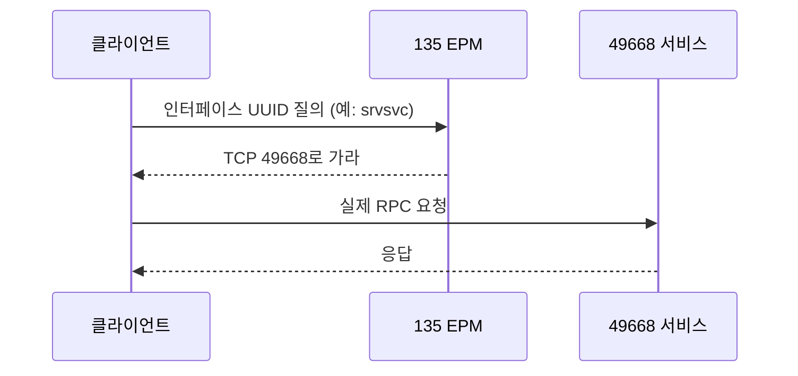
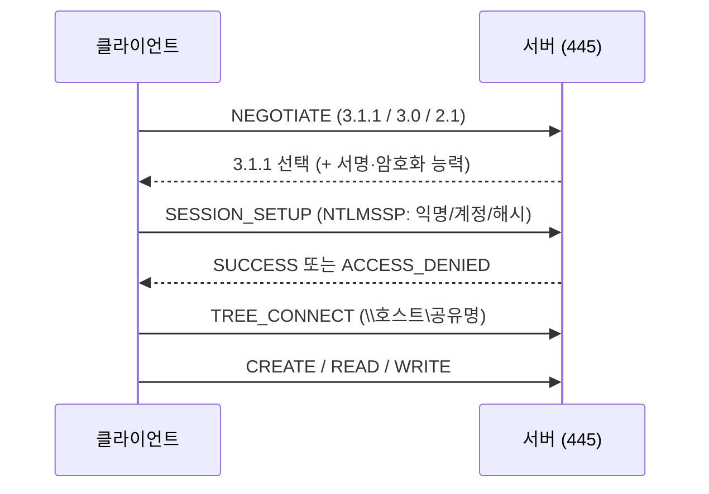
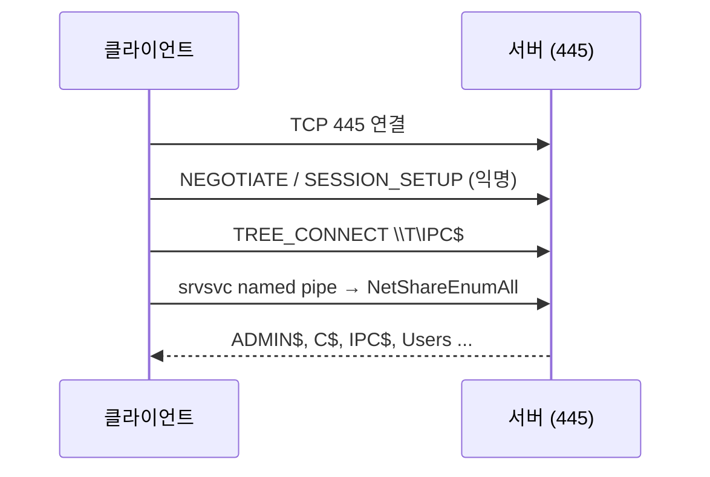

# SMB 포트 지도: 135 / 139 / 445

스캔 결과에서 135·139·445를 보고 "SMB를 파볼까, 어떤 도구를 쓸까"를 판단하기 위한 단일 문서. 설치부터 creds 재사용까지 여기서 끝낸다. 상세한 smbclient 사용법은 같은 폴더의 `smbclient.md`에 있다.

---

## 0. 30초 결정 트리

```
nmap -p135,139,445,3389 <IP>
        │
        ├── 445 open ─────────► SMB2/3 본선
        │                       ├─ smbclient -L //IP -N
        │                       ├─ smbmap -H IP -u '' -p ''
        │                       ├─ nxc smb IP -u '' -p '' --shares
        │                       └─ 공유 잡히면: recurse ON; mget *
        │
        ├── 139만 open ───────► SMB1/NetBIOS 세계 (도구를 바꿔야 함)
        │                       ├─ nmblookup -A IP
        │                       ├─ smbclient -L //IP -p 139 -N
        │                       └─ enum4linux-ng -A IP
        │
        ├── 135 open (보조) ──► 열거 입구
        │                       ├─ rpcdump.py @IP
        │                       └─ rpcclient -U '' -N IP -c 'enumdomusers'
        │
        └── 445·139 closed ───► SMB 포기, 웹/RDP로 이동
```

기억할 분기점은 두 개다.

1. 445가 열렸는가 → 도구 선택이 정해진다.
2. 익명·게스트 인증이 통하는가 → 열람 가능 여부가 정해진다.

## 1. 준비

### 1.1 도구 설치

```bash
sudo apt update
sudo apt install -y smbclient smbmap nbtscan enum4linux-ng python3-impacket netexec
# rpcdump.py는 python3-impacket 패키지에 포함됨 (Kali 최신은 impacket-rpcdump 이름)
pipx install netexec        # apt에 없으면 폴백
```

최소 구성은 `smbclient` + `nmap` 두 개다. 나머지는 기능별로 건너뛰면 된다.

### 1.2 도구별 역할

| 도구 | 하는 일 | 쓰는 순간 |
|---|---|---|
| `nmap` | 포트·버전·SMB 설정 확인 | 가장 먼저 |
| `smbclient` | 공유 목록·내부 탐색·다운로드·업로드 | 파일을 직접 봐야 할 때 |
| `smbmap` | 공유별 읽기/쓰기 권한과 트리 요약 | 여러 공유를 빠르게 훑을 때 |
| `nxc` (netexec) | 인증 검증, `--shares`, `--spider` | creds를 얻은 뒤 |
| `rpcclient` | 계정·그룹·공유·정책 열거 (MSRPC) | 135/139/445 중 하나라도 열렸을 때 |
| `rpcdump.py` | RPC 엔드포인트 지도 출력 | 135가 열렸을 때 |
| `nmblookup` / `nbtscan` | NetBIOS 이름·워크그룹·MAC 확인 | 137이 열렸을 때 |
| `enum4linux-ng` | 위 기능 종합 | 손이 적을 때 |
| `impacket-smbclient` | 파이썬 구현 SMB 클라이언트 | smbclient 협상 실패 시 |

## 2. 등장인물

| 포트 | 프로토콜 | 정식 이름 | Windows 쪽 주체 | 역할 |
|---|---|---|---|---|
| 135/tcp | MSRPC | Endpoint Mapper (EPM) | RpcSs (svchost) | RPC 서비스의 전화번호 안내소 |
| 137/udp | NetBIOS-NS | Name Service | NetBT (netbt.sys) | 컴퓨터 이름 ↔ IP |
| 138/udp | NetBIOS-DGM | Datagram Service | NetBT | 네트워크 환경 목록, 브로드캐스트 |
| 139/tcp | NetBIOS-SSN | Session Service | NetBT + Server | SMB1을 실어 나르는 세션 통로 |
| 445/tcp | SMB | SMB direct hosting | Server (LanmanServer, PID 4) | SMB2/3 파일 공유 본진 |

비유로 잡으면 이렇다.

```
135 = 빌딩 안내데스크   "회계팀은 몇 호실?" → "49668호"
137 = 전화번호부        "MIKE-PC" → 192.168.165.180
139 = 옛 구내 우편관    낡았지만 문이 열려 있음
445 = 정문 직결 출입구  짐(파일)을 직접 들고 나를 수 있음
```

한 줄 정리: 파일을 만질 수 있느냐는 445가 결정하고, 135는 누가 그 파일에 접근 가능한지 캐는 입구이며, 139는 옛 통로가 아직 열려 있는지 보여주는 지표다.

## 3. 135/tcp: RPC Endpoint Mapper

### 3.1 원리

Windows의 주요 기능(WMI, 서비스 제어, 계정 관리, 이벤트 로그, 작업 스케줄러, DCOM, 공유 열거)은 MSRPC로 구현된다. 이들은 고정 포트를 쓰지 않고 부팅할 때마다 동적 포트(Windows Vista 이후 49152~65535)를 잡는다. 그래서 "원하는 인터페이스가 어느 포트에 있는지" 물어볼 안내소가 필요하고, 그게 135다. 135는 요청을 중계하지 않는다. "어디로 가라"는 주소만 알려주고 빠진다.



### 3.2 스캔에서 보이는 것

`-p-` 스캔에 `49664~49669` 같은 정체불명 포트가 줄줄이 뜨는 이유가 이것이다. 별도 프로그램이 아니라 svchost가 잡은 RPC 동적 엔드포인트다. 135에 물어보면 각각의 정체가 나온다.

```bash
rpcdump.py @192.168.165.180        # 없으면: impacket-rpcdump 192.168.165.180
rpcclient -U '' -N 192.168.165.180 -c 'enumdomusers; enumdomgroups; netshareenumall'
```

135가 열려 있다는 것 자체는 큰 위험이 아니다. 다만 인증 전에도 어떤 서비스가 살아 있는지 지도를 그릴 수 있다는 뜻이고, 계정명을 얻으면 3389·웹 로그인에 재사용할 수 있다.

## 4. 137/138/139: NetBIOS over TCP/IP

NetBIOS는 1980년대 IBM PC용 통신 API였고, TCP/IP 시대에 얹은 것이 NBT(NetBIOS over TCP/IP)다. 세 포트가 서로 다른 계층을 맡는다.

```
   애플리케이션 (SMB1, 파일 공유)
   ─────────────────────────────
   NetBIOS 세션 서비스  ← 139/tcp   연결 지향, SMB1 캡슐화
   NetBIOS 데이터그램   ← 138/udp   비연결, 목록 공지
   NetBIOS 이름 서비스  ← 137/udp   이름 등록·해석
```

139가 하는 일: SMB1 패킷 앞에 4바이트 NetBIOS 세션 헤더(타입 `0x00` + 3바이트 길이)를 붙여 나른다. 즉 139는 SMB를 감싸는 봉투다. 2000년 이후 445가 등장해 봉투 없이 보내게 됐지만 하위 호환 때문에 지금도 기본으로 열려 있는 PC가 많다.

```bash
nmblookup -A 192.168.165.180
nbtscan 192.168.165.180
smbclient -L //192.168.165.180 -p 139 -N
```

보안 관점에서 137/138이 열려 있다는 건 그 네트워크가 브로드캐스트 이름 해석에 의존한다는 신호다. 같은 대역에서 NBT-NS/LLMNR 포이즈닝(Responder 계열)이 통할 여지가 있다는 뜻이기도 하다.

## 5. 445/tcp: SMB direct hosting

### 5.1 프레임 비교

NetBIOS 봉투를 벗겨내고 SMB 메시지를 TCP에 그대로 올린 것. 첫 바이트가 `0xFF`면 SMB1, `0xFE`면 SMB2 이상이다.

```
139 (SMB1 over NBT)          445 (SMB2/3 direct)
┌────────────┬──────────┐     ┌──────────────────┐
│ NBT 4B     │ SMB1     │     │ SMB2 메시지      │
│ 00+길이    │ FF 53... │     │ FE 53 4D 42 ...  │
└────────────┴──────────┘     └──────────────────┘
```

### 5.2 접속하면 벌어지는 일



협상 단계에서 정해지는 것이 곧 공격면이다.

| 협상 결과 | 의미 | 공격적 함의 |
|---|---|---|
| SMB1 선택됨 | 구형 스택 | MS17-010 등 SMB1 취약점 후보 |
| 서명 required | 무결성 강제 | SMB 릴레이 불가 |
| 서명 disabled | 무결성 없음 | NTLM 릴레이 성립 가능 |
| SMB3 암호화 | 전 구간 암호화 | 패킷 분석으로 내용 확인 불가 |
| 익명/게스트 성공 | 인증 없는 접근 | 즉시 공유 열람 |

```bash
nmap -p445 --script smb-protocols,smb2-security-mode,smb-security-mode,smb-vuln-ms17-010 192.168.165.180
```

### 5.3 공유 목록은 사실 SMB 명령이 아니다

`smbclient -L`은 공유를 SMB로 나열하는 게 아니라 `IPC$`에 붙어 `srvsvc` RPC를 호출한다. 그래서 445가 열려 있어도 목록이 안 나올 수 있다. 포트 문제가 아니라 IPC$ 접근 권한 문제다.



## 6. 왜 445가 분기점인가

1. 도구 기본값이다. `smbclient`, `smbmap`, `nxc smb`는 445를 먼저 친다. 445가 닫히면 `-p 139`를 명시해야 하고, 최신 도구는 SMB1 협상에서 그냥 실패한다.
2. 최신 기능 판정이 전부 445에서 이뤄진다. 서명 강제, SMB3 암호화, NTLM 릴레이 가능성은 SMB2/3 협상 결과다.
3. 파일을 읽는 유일한 길이다. 설정 파일, 백업, 스크립트, 자격증명 메모는 445로만 나온다.
4. 139만 열린 경우 시나리오가 완전히 달라진다. 이름 해석부터 시작해 SMB1 친화 도구로 내려가야 하므로 명령과 기대치가 바뀐다.

## 7. 도구 치트

목적 → 명령 한 줄. 상세 옵션은 `smbclient.md` 참조.

```bash
# 표면 확인
nmap -Pn -p135,139,445,3389 -sV --script smb-os-discovery,smb-protocols,smb2-security-mode <IP>

# 이름 해석 (137)
nmblookup -A <IP> ; nbtscan <IP>

# 열거 (445, 익명)
smbclient -L //<IP> -N
smbmap -H <IP> -u '' -p ''
nxc smb <IP> -u '' -p '' --shares

# 139만 열린 경우
smbclient -L //<IP> -p 139 -N
enum4linux-ng -A <IP>

# RPC 지도 (135)
rpcdump.py @<IP>        # 없으면: impacket-rpcdump <IP>
rpcclient -U '' -N <IP> -c 'enumdomusers; enumdomgroups; netshareenumall'

# 공유 진입 후 재귀 수집
smbclient //<IP>/<SHARE> -N
#   recurse ON; prompt OFF; mask *; mget *

# 인증 재사용
smbclient //<IP>/<SHARE> -U '<USER>%<PASS>' -c 'ls'
nxc smb <IP> -u '<USER>' -p '<PASS>' --shares

# SMB1 강제 (협상 실패 시)
smbclient //<IP>/<SHARE> -N --option='client min protocol=NT1'

# 해시 인증 (Pass-the-Hash)
smbclient //<IP>/C$ -U Administrator --pw-nt-hash <NTHASH>
```

## 8. 응답 메시지 해석

| 응답 | 발생 단계 | 의미 | 다음 |
|---|---|---|---|
| `NT_STATUS_ACCESS_DENIED` | 목록/트리 | 인증은 됐지만 권한 없음, 또는 IPC$ 차단 | creds 확보 후 재시도 |
| `NT_STATUS_LOGON_FAILURE` | 세션 설정 | 계정 인증 실패 | 웹에서 얻은 creds 재사용 |
| `NT_STATUS_ACCOUNT_RESTRICTION` | 세션 설정 | 게스트/익명 차단 정책 | 익명 경로 포기 |
| `NT_STATUS_BAD_NETWORK_NAME` | 트리 연결 | 공유명 오타 또는 삭제됨 | 목록 다시 확인 |
| `NT_STATUS_CONNECTION_REFUSED` | TCP | 445 닫힘 | `-p 139` 시도 |
| `protocol negotiation failed` | 협상 | SMB1 필요/차단 | `--option='client min protocol=NT1'` |
| `Sharename`에 `IPC$`만 | 열거 | 기본 특수 공유만 존재 | `ADMIN$`/`C$`는 관리자 creds 필요 |
| `Disk` + `READ/WRITE` | 열거 | 실제 진입점 | `recurse ON; prompt OFF; mget *` |

기본 공유의 성격:

| 공유 | 정체 | 접근 조건 |
|---|---|---|
| `IPC$` | named pipe 전용, RPC 통로 | 익명 허용 시 열거 가능 |
| `ADMIN$` | `C:\Windows` | 관리자 권한 |
| `C$`, `D$` | 드라이브 루트 | 관리자 권한 |
| `Users`, `Shared`, `Backup` 등 | 관리자가 만든 공유 | 공유 ACL에 따라 |

## 9. 실전 순서

1. 표면 확인: `nmap -Pn -p135,139,445,3389 -sV --script smb-os-discovery,smb-protocols,smb2-security-mode IP`
2. 이름 확보: 137이 열렸으면 `nmblookup -A IP`
3. 익명 시도: `smbclient -L //IP -N` → 성공하면 7절 재귀 수집
4. 권한 지도: `smbmap -H IP` 또는 `nxc smb IP -u '' -p '' --shares`
5. 계정 열거: `rpcclient -U '' -N IP -c 'enumdomusers'`
6. 웹·설정 파일에서 creds 확보 후 3~5를 계정으로 반복
7. creds 재사용: 445(공유), 3389(RDP), 웹 로그인, WinRM(5985)
8. 관리자 creds면 `ADMIN$`/`C$`로 파일 배치 → 서비스·작업 스케줄러 경로

## 10. 실제 케이스 적용: 192.168.165.180

```
                    192.168.165.180  (MIKE-PC, 워크그룹)
 ────────────────────────────────────────────────────────────
 80/tcp   Apache 2.4.41 (Win64) PHP 7.3.10
 443/tcp  같은 웹 (self-signed, CN=localhost)
            └─ /blog → Monstra CMS 3.0.4
               └─ 인증 RCE 2건 (49949.py, 52038.py)
 135/tcp  RPC EPM → 49664~49669 동적 엔드포인트
 139/tcp  NetBIOS 세션 (SMB1 통로 잔존)
 445/tcp  SMB → 공유 열람·다운로드 (본선)
 3389/tcp RDP → creds 확보 시 최종 진입점
 7680/tcp Delivery Optimization (Win10 계열 방증)
 5040/tcp 공식 문서에 없는 포트 → 135에 질의해 확인
 ────────────────────────────────────────────────────────────
```

읽는 순서:

1. 웹이 이미 뚜껑이 열려 있다. 주 경로는 Monstra 3.0.4.
2. 445가 열려 있으니 `smbclient -L //192.168.165.180 -N` 한 번은 던진다. 웹 루트나 백업이 공유로 노출돼 있으면 `config.php` 계열에서 DB·관리자 creds가 바로 나온다.
3. 얻은 creds를 445, 3389, 웹 로그인에 동시에 재사용한다. 단독 PC이므로 로컬 계정 하나가 전부를 연다.
4. 139는 "SMB1이 살아 있다"는 정보로만 쓰고, 이름·워크그룹 확정에 `nbtscan`을 쓴다.

## 11. 눈으로 확인하기 (Wireshark)

| 필터 | 보이는 것 |
|---|---|
| `tcp.port == 445` | SMB2/3 전체 흐름 |
| `smb2` | 협상·세션·트리 연결, dialect |
| `smb2.cmd == 0` | NEGOTIATE (서버가 고른 dialect 확인) |
| `nbss` | NetBIOS 세션(139) 위 SMB1 |
| `dcerpc` | named pipe 위 RPC (`srvsvc` 등) |
| `nbns` | 137 이름 질의/응답 |
| `ntlmssp` | 인증 협상, 익명 여부 |

`smb2.cmd == 0`을 열면 dialect가 숫자로 보인다. `0x0311`이면 SMB 3.1.1이다.

## 12. 오해 정리

- "139가 열렸으니 SMB를 털 수 있다" → 139는 통로일 뿐이고, 실제 열람 권한은 계정·ACL이 결정한다. 최신 도구는 445를 전제하므로 139만으로는 할 수 있는 게 확 줄어든다.
- "445가 열렸으니 공유가 익명으로 열려 있다" → 445 open은 서비스가 응답한다는 뜻일 뿐이다. 익명 열거는 IPC$ 접근 권한이 따로 필요하다.
- "공유 목록이 안 나오니 SMB는 막혔다" → `ACCESS_DENIED`는 목록 권한 문제다. creds를 넣으면 열리는 경우가 많다.
- "135는 위험하지 않다" → 단독으로는 사실이지만, 계정명·정책을 캐서 다른 서비스의 브루트포스 재료를 만들어 준다.
- "게스트 접근은 항상 된다" → Windows 10 1709 이후 비보안 게스트 인증이 기본 차단이라 `-U 'guest%'`는 대개 실패한다.
- "SMB1 취약점은 다 된다" → MS17-010은 SMB1이 켜져 있고 패치가 없을 때만 성립한다. `smb-protocols`로 먼저 확인한다.

## 13. 자주 막히는 상황 (FAQ)

Q. `smbclient -L`이 `NT_STATUS_ACCESS_DENIED`를 뱉는다.
A. 포트는 열려 있지만 IPC$ 접근이 막혀 있다. creds를 얻은 뒤 `-U 'user%pass'`로 재시도한다.

Q. 445는 닫혀 있고 139만 열려 있다.
A. `nmblookup -A`로 이름을 먼저 얻고 `smbclient -L //IP -p 139 -N`을 쓴다. 최신 도구(nxc 등)는 실패할 수 있다.

Q. 게스트 접근이 `NT_STATUS_ACCOUNT_RESTRICTION`으로 실패한다.
A. Windows 10 이후 기본 차단이다. 익명 경로를 포기하고 계정 확보로 전환한다.

Q. 공유는 보이는데 파일이 안 받아진다.
A. READ 권한이 없는 공유다. `smbmap`으로 권한을 다시 확인하고, WRITE 가능 공유를 찾는다.

Q. `protocol negotiation failed`가 뜬다.
A. 서버가 SMB1만 허용하거나 클라이언트가 SMB1을 거부하는 경우다. `--option='client min protocol=NT1'`로 맞춘다.

Q. 49664~49669가 뭔지 모르겠다.
A. RPC 동적 엔드포인트다. `rpcdump.py @IP`로 각각의 정체를 확인한다.
